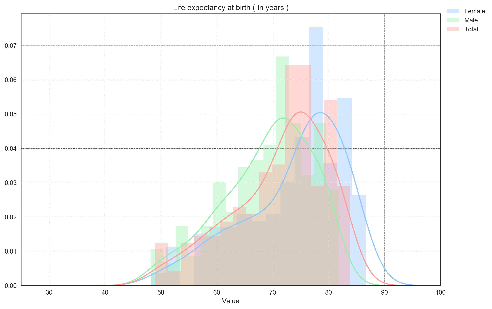
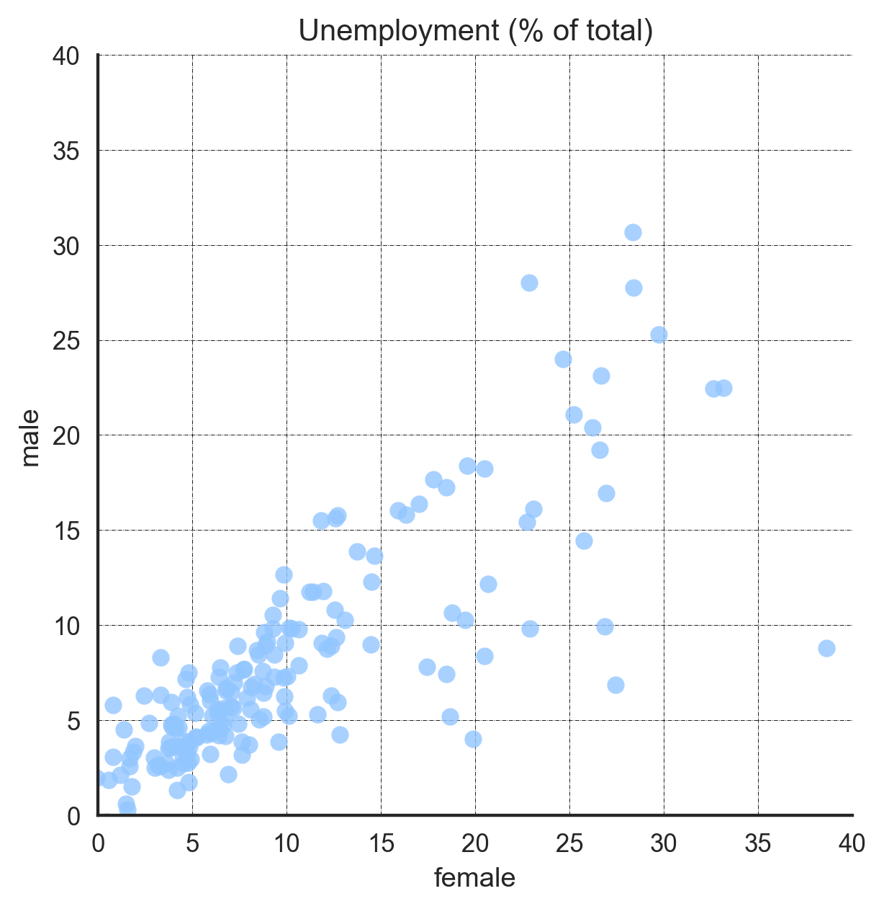
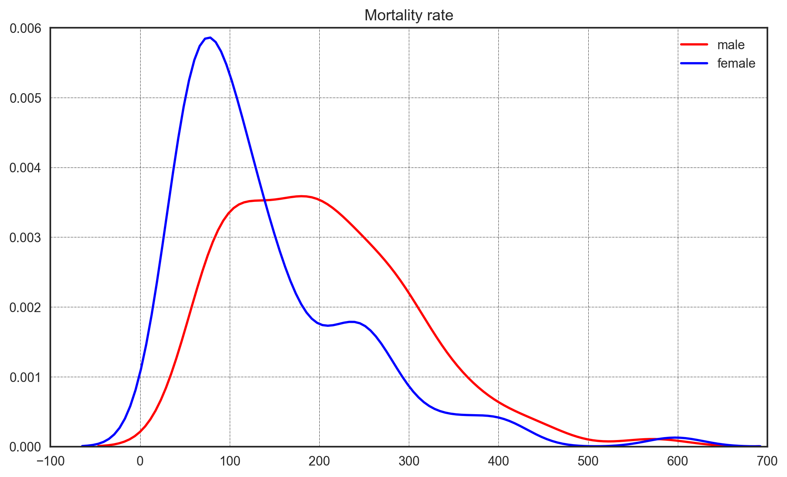
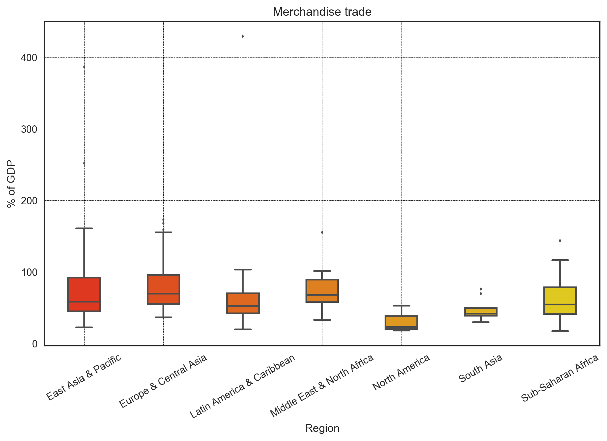
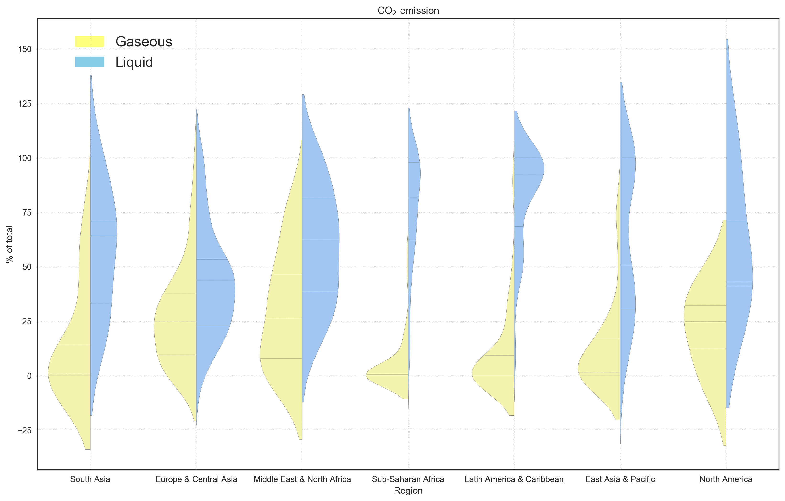
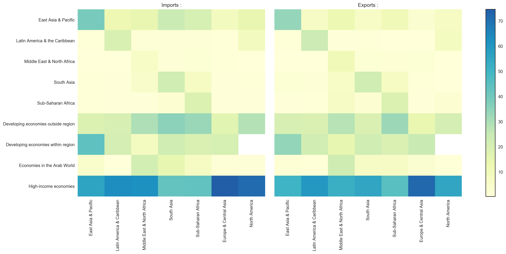
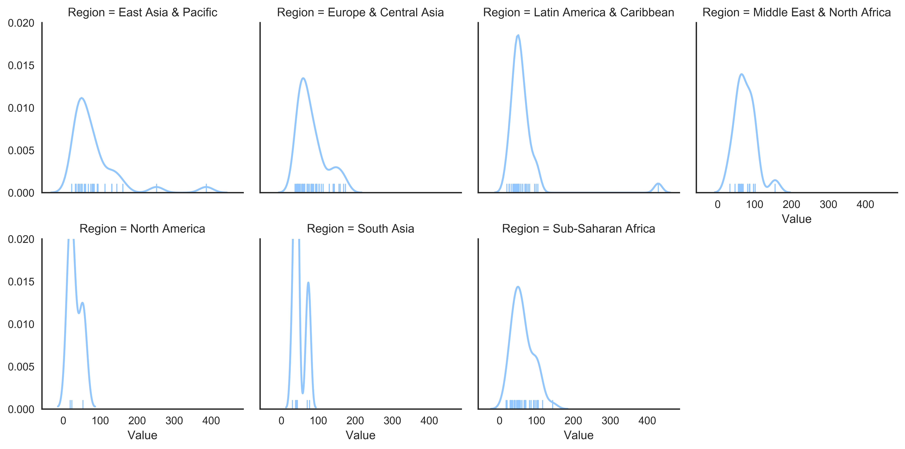

A distribution is the set of values a variable takes, together with how often each value shows up.

This is a tour of seven seaborn plots, in the order the original notebook tried them. Five of them are distribution plots in the strict sense, different views of one column holding one value per country per indicator. The scatter and the heatmap are cheats that stayed in, one for two columns at once, one for a whole matrix.

<div class="notice--info" markdown="1">
**Updated 2023.** I wrote this in 2017 against seaborn's old `distplot` helper. seaborn deprecated `distplot` in v0.11 (2020), so the code blocks below use `histplot(kde=True)`, `kdeplot`, and `rugplot`. The figures are the originals.
</div>

## Data

The data is the World Bank's World Development Indicators, packaged into one `database.sqlite`.

<style>
a.btn-soft {
  display: inline-block;
  margin: 0 0.5rem 0.55rem 0;
  padding: 0.5em 1.05em;
  font-size: 0.92rem;
  font-weight: 500;
  line-height: 1.3;
  color: inherit;
  text-decoration: none;
  border-radius: 8px;
  border: 1px solid rgba(128, 128, 128, 0.30);
  border: 1px solid color-mix(in srgb, currentColor 22%, transparent);
  background: rgba(128, 128, 128, 0.06);
  background: color-mix(in srgb, currentColor 5%, transparent);
  transition: background-color .18s ease, border-color .18s ease, color .18s ease;
}
a.btn-soft:hover {
  text-decoration: none;
  border-color: rgba(128, 128, 128, 0.55);
  border-color: color-mix(in srgb, currentColor 42%, transparent);
  background: rgba(128, 128, 128, 0.12);
  background: color-mix(in srgb, currentColor 11%, transparent);
}
a.btn-soft--primary {
  font-weight: 600;
  border-color: rgba(128, 128, 128, 0.55);
  border-color: color-mix(in srgb, currentColor 42%, transparent);
}
</style>

It is the Kaggle packaging, the same file the code below queries.

[Grab the World Development Indicators dataset on Kaggle](https://www.kaggle.com/datasets/kaggle/world-development-indicators){: .btn-soft .btn-soft--primary}

```python
%pylab inline

import pandas as pd
import seaborn as sns
import sqlite3


db_path = './data/world-development-indicators/database.sqlite'

conn = sqlite3.connect(db_path)
db = conn.cursor()
db.execute("SELECT name FROM sqlite_master WHERE type='table';")
print(db.fetchall())

data_countries = pd.read_sql_query('select * from Country',conn)
data_series = pd.read_sql_query('select * from Series',conn)
data_indicators = pd.read_sql_query('select * from Indicators',conn)

```

`data_indicators` is a long table. There is one row per `CountryName` x `IndicatorName` x `Year`, with the number itself in `Value`.

Most of the data-prep blocks below are the same four moves. You filter `data_indicators` down to the indicator strings you want. You drop aggregate rows by keeping only countries that carry a real `Region`. You sort and take each country's last available year. You group to one row per country per indicator. Where a section needs two indicators side by side, it pivots them into columns at the end.

## Histogram

First plot in the notebook, and the simplest: life expectancy at birth, dropped into bins.

```python

# Data Prep

selected_indicators = ['Life expectancy at birth, female (years)',
                       'Life expectancy at birth, male (years)',
                       'Life expectancy at birth, total (years)']
countries = data_countries.CountryCode[data_countries.Region!=''].unique()
condition = data_indicators.IndicatorName.isin(selected_indicators)

data_plot = data_indicators.loc[condition,:]
condition = data_plot.CountryCode.isin(countries)
data_plot = data_plot.loc[condition,:]
data_plot.sort_values(['CountryName','IndicatorName','Year'], inplace=True)

data_plot = data_plot.groupby(['CountryName','IndicatorName'], as_index=False).last()
data_plot[['feature','type']] = data_plot['IndicatorName'].str.split(', ',expand=True)
data_plot.reset_index(inplace=True, drop=True)

# Visualisation

nbins = 15
sns.set(style="white",
        palette="pastel",
        color_codes=True,
        rc={'figure.figsize':(12,8),
            'figure.dpi':500})

sns.histplot(data_plot.Value[data_plot.type=='female (years)'], bins=nbins, kde=True, stat="density")
sns.histplot(data_plot.Value[data_plot.type=='male (years)'], bins=nbins, kde=True, stat="density")
sns.histplot(data_plot.Value[data_plot.type=='total (years)'], bins=nbins, kde=True, stat="density")
plt.legend(['Female', 'Male', 'Total'], bbox_to_anchor=(1.12,1.04))
plt.xlim((25,100))
plt.grid(color='black',linestyle='-.',linewidth=0.25)
plt.title('Life expectancy at birth ( In years )')
```

<figure>

<figcaption>The mass sits high, near 70 to 80 years, with a long tail running down toward 50.</figcaption>
</figure>

The KDE curves from `kde=True` do most of the work of telling the three apart.

## Scatter

The scatter is the first cheat. Right after looking at one number per country at a time I wanted two, male and female unemployment, and the question of whether they move together.

```python

# Data Prep

selected_indicators = ['Unemployment, female (% of female labor force)',
                       'Unemployment, male (% of male labor force)']

countries = data_countries.CountryCode[data_countries.Region!=''].unique()
condition = data_indicators.IndicatorName.isin(selected_indicators)

data_plot = data_indicators.loc[condition,:]
condition = data_plot.CountryCode.isin(countries)
data_plot = data_plot.loc[condition,:]
data_plot.sort_values(['CountryName','IndicatorName','Year'], inplace=True)

data_plot = data_plot.groupby(['CountryName','IndicatorName'], as_index=False).last()
data_plot[['feature','type']] = data_plot['IndicatorName'].str.split(', ',expand=True)
data_plot.reset_index(inplace=True, drop=True)
data_plot['type'] = data_plot.type.str.replace(' \(% of male labor force\)','', regex=True)
data_plot['type'] = data_plot.type.str.replace(' \(% of female labor force\)','', regex=True)
data_plot = data_plot.pivot_table(values='Value',index='CountryName',columns='type')

# Visualisation

sns.set(style="white",
        palette="pastel",
        rc={'figure.figsize':(7,5),
            'figure.dpi':500})

sns.lmplot(x = 'female', y = 'male', data = data_plot, fit_reg=False, x_jitter=1.5, y_jitter=1.5)
plt.xlim((0,40))
plt.ylim((0,40))
plt.grid(color='black', linestyle='-.', linewidth=0.25)
plt.title('Unemployment (% of total)',)
plt.savefig('./plots/02.scatter.png',orientation='landscape',dpi=500);
```

`fit_reg=False` keeps `lmplot` from drawing a regression line. The `x_jitter=1.5` and `y_jitter=1.5` nudge overlapping points apart.

<figure>

<figcaption>Female rate as % of the female labor force, male rate as % of the male labor force.</figcaption>
</figure>

Most countries crowd into the corner below 10 percent on both axes. Further out the cloud leans under the 45-degree line, where the female rate is the higher one, and one country sits near 38 percent female against 9 percent male.

## Density

A kernel density estimate is the histogram's smooth cousin. The bin count comes back as the bandwidth, buried inside seaborn's default Scott rule. Here it is adult mortality.

```python

# Data Prep

selected_indicators = ['Mortality rate, adult, female (per 1,000 female adults)',
                       'Mortality rate, adult, male (per 1,000 male adults)']

countries = data_countries.CountryCode[data_countries.Region!=''].unique()
condition = data_indicators.IndicatorName.isin(selected_indicators)

data_plot = data_indicators.loc[condition,:]
condition = data_plot.CountryCode.isin(countries)
data_plot = data_plot.loc[condition,:]
data_plot.sort_values(['CountryName','IndicatorName','Year'], inplace=True)

data_plot = data_plot.groupby(['CountryName','IndicatorName'], as_index=False).last()
data_plot[['feature','type']] = data_plot['IndicatorName'].str.split(', adult, ',expand=True)
data_plot.reset_index(inplace=True, drop=True)
data_plot['type'] = data_plot.type.str.replace(' \(per 1,000 female adults\)','', regex=True)
data_plot['type'] = data_plot.type.str.replace(' \(per 1,000 male adults\)','', regex=True)
data_plot = data_plot.pivot_table(values='Value',index='CountryName',columns='type')

# Visualisation

sns.set(style="white",
        palette="pastel",
        color_codes=True,
        rc={
            'figure.figsize':(10,6),
            'figure.dpi':200
           })

sns.kdeplot(data=data_plot, x='male', color='red')
sns.kdeplot(data=data_plot, x='female', color='blue')
plt.grid(color='black',linestyle='-.', linewidth=0.25)
plt.title('Mortality rate')
plt.ylim((0,0.006))
plt.xlim((-100,700))
plt.savefig('./03.density.png');
```

Male is the red curve and female the blue. Look at `plt.xlim((-100,700))`. The kernel smears probability mass below zero, into mortality rates that cannot exist.

<figure>

<figcaption>Adult mortality per 1,000 adults. The female curve peaks sharply near 75, the male curve is a broad plateau from about 100 to 200.</figcaption>
</figure>

## Box and violin

So far the column stayed ungrouped. The next thing I wanted was the same shape split by region, and seaborn has two plots for that. A box plot keeps the five-number summary per group and throws the rest away. A violin adds back the kernel shape.

First the `boxplot`. This one is merchandise trade as a share of GDP, split by world region.

```python

# Data Prep

selected_indicators = ['Merchandise trade (% of GDP)']

countries = data_countries.CountryCode[data_countries.Region!=''].unique()
condition = data_indicators.IndicatorName.isin(selected_indicators)

data_plot = data_indicators.loc[condition,:]
condition = data_plot.CountryCode.isin(countries)
data_plot = data_plot.loc[condition,:]
data_plot.sort_values(['CountryName','IndicatorName','Year'], inplace=True)

data_plot = data_plot.groupby(['CountryName','IndicatorName'], as_index=False).last()
data_plot.reset_index(inplace=True, drop=True)
data_plot['Region'] = data_plot.merge(right=data_countries,on='CountryCode',how='left')['Region']

# Visualisation

columns_order = sorted(data_plot.Region.unique())

sns.set(style="white",
        palette="pastel",
        color_codes=True,
        rc={
            'figure.figsize':(10,6),'figure.dpi':200
           })

sns.boxplot(x='Region',
            y='Value',
            palette='autumn',
            order=columns_order,
            width=0.4,
            fliersize=3,
            data=data_plot);
plt.grid(color='black',linestyle='-.', linewidth=0.25)
plt.xticks(rotation=30)
plt.title('Merchandise trade')
plt.ylabel('% of GDP');
plt.savefig('./04.boxplot.png');
```

<figure>

<figcaption>Merchandise trade as a share of GDP.</figcaption>
</figure>

Now the violin. This one splits each region in half, gaseous against liquid CO2 emissions.

```python

# Data Prep

selected_indicators = [ 'CO2 emissions from gaseous fuel consumption (% of total)',
                        'CO2 emissions from liquid fuel consumption (% of total)']

countries = data_countries.CountryCode[data_countries.Region!=''].unique()
condition = data_indicators.IndicatorName.isin(selected_indicators)

data_plot = data_indicators.loc[condition,:]
condition = data_plot.CountryCode.isin(countries)
data_plot = data_plot.loc[condition,:]
data_plot.sort_values(['CountryName','IndicatorName','Year'], inplace=True)

data_plot = data_plot.groupby(['CountryName','IndicatorName'], as_index=False).last()
data_plot.reset_index(inplace=True, drop=True)
data_plot['Region'] = data_plot.merge(right=data_countries,on='CountryCode',how='left')['Region']

# Visualisation

import matplotlib.patches as mpatches

columns_order = sorted(data_plot.Region.unique())

sns.set(style="white",
        palette="pastel",
        color_codes=True,
        rc={
            'figure.figsize':(16,10),'figure.dpi':250
           })
sns.violinplot(x ='Region',
               y='Value',
               hue='IndicatorName',
               linewidth=0.25,
               inner="quart",
               palette={"CO2 emissions from gaseous fuel consumption (% of total)": "y",
                        "CO2 emissions from liquid fuel consumption (% of total)": "b"},
               data=data_plot,
               split=True)
plt.grid(color='black',linestyle='-.', linewidth=0.25)
plt.title('CO$_2$ emission')
plt.ylabel('% of total')

gas_patch = mpatches.Patch(color='yellow', label='Gaseous',alpha=0.5)
liquid_patch = mpatches.Patch(color='skyblue', label='Liquid')
plt.legend(handles=[gas_patch, liquid_patch], bbox_to_anchor=(0.2, 0.99), fontsize='x-large')
plt.savefig('./plots/05.violinplot.png', dpi=250, bbox_inches='tight');
```

Gaseous goes on one side, liquid on the other, with quartile lines drawn inside each half.

<figure>

<figcaption>The gaseous halves in Sub-Saharan Africa, Latin America and East Asia bulge near zero. The silhouettes also run below 0 and past 100 percent, the same kernel smear as in the density plot.</figcaption>
</figure>

## Heatmap

The second cheat. By this point the notebook had drifted from single indicators to a whole matrix of them, merchandise trade split by region and by trade partner.

```python

# Data Prep

selected_indicators_export = [
    'Merchandise exports to developing economies in East Asia & Pacific (% of total merchandise exports)',
    'Merchandise exports to developing economies in Latin America & the Caribbean (% of total merchandise exports)',
    'Merchandise exports to developing economies in Middle East & North Africa (% of total merchandise exports)',
    'Merchandise exports to developing economies in South Asia (% of total merchandise exports)',
    'Merchandise exports to developing economies in Sub-Saharan Africa (% of total merchandise exports)',
    'Merchandise exports to developing economies outside region (% of total merchandise exports)',
    'Merchandise exports to developing economies within region (% of total merchandise exports)',
    'Merchandise exports to economies in the Arab World (% of total merchandise exports)',
    'Merchandise exports to high-income economies (% of total merchandise exports)'
]

selected_indicators_imports = [
    'Merchandise imports from developing economies in East Asia & Pacific (% of total merchandise imports)',
    'Merchandise imports from developing economies in Latin America & the Caribbean (% of total merchandise imports)',
    'Merchandise imports from developing economies in Middle East & North Africa (% of total merchandise imports)',
    'Merchandise imports from developing economies in South Asia (% of total merchandise imports)',
    'Merchandise imports from developing economies in Sub-Saharan Africa (% of total merchandise imports)',
    'Merchandise imports from developing economies outside region (% of total merchandise imports)',
    'Merchandise imports from developing economies within region (% of total merchandise imports)',
    'Merchandise imports from economies in the Arab World (% of total merchandise imports)',
    'Merchandise imports from high-income economies (% of total merchandise imports)'
]

countries = data_countries.CountryCode[data_countries.Region!=''].unique()
condition = data_indicators.IndicatorName.isin(selected_indicators_export)
data_plot = data_indicators.loc[condition,:]
condition = data_plot.CountryCode.isin(countries)
data_plot = data_plot.loc[condition,:]
data_plot.sort_values(['CountryName','IndicatorName','Year'], inplace=True)
data_plot = data_plot.groupby(['CountryName','IndicatorName'], as_index=False).last()
data_plot.reset_index(inplace=True, drop=True)
data_plot['Region'] = data_plot.merge(right=data_countries,on='CountryCode',how='left')['Region']
data_export = data_plot.pivot_table(values='Value',columns='Region',index='IndicatorName')


countries = data_countries.CountryCode[data_countries.Region!=''].unique()
condition = data_indicators.IndicatorName.isin(selected_indicators_imports)
data_plot = data_indicators.loc[condition,:]
condition = data_plot.CountryCode.isin(countries)
data_plot = data_plot.loc[condition,:]
data_plot.sort_values(['CountryName','IndicatorName','Year'], inplace=True)
data_plot = data_plot.groupby(['CountryName','IndicatorName'], as_index=False).last()
data_plot.reset_index(inplace=True, drop=True)
data_plot['Region'] = data_plot.merge(right=data_countries,on='CountryCode',how='left')['Region']
data_import = data_plot.pivot_table(values='Value',columns='Region',index='IndicatorName')

# Visualisation

sns.set(style="white",
        color_codes=True,
        rc={
            'figure.figsize':(20,8),
            'figure.dpi':250
           })
fig, (imports, exports) = plt.subplots(1, 2, sharex=True)

im1 = sns.heatmap(data_import.loc[:,xlabels],
                  ax=imports,
                  center=50,
                  cbar=False,
                  cmap="YlGnBu")
imports.set_yticklabels(ylabels)
imports.set_ylabel('')
imports.set_xlabel('')
imports.set_title('Imports :');

im2 = sns.heatmap(data_export.loc[:,xlabels],
                  ax=exports,
                  center=50,
                  yticklabels=False,
                  cbar=False,
                  cmap="YlGnBu")
exports.set_ylabel('')
exports.set_xlabel('')
exports.set_title('Exports :');
fig.subplots_adjust(wspace=0.05, hspace=0)

mappable = im1.get_children()[0]
fig.colorbar(mappable, ax = [imports,exports],orientation = 'vertical')
plt.savefig('./plots/06.heatmap.png', dpi=250, bbox_inches='tight');
```

Two heatmaps share a colorbar, imports on the left and exports on the right. Each cell is the mean over the countries in a region, `pivot_table`'s default. This block references `xlabels` and `ylabels` that I defined further up in the original notebook and never carried into the post. They are just the column order and the row labels for the two pivot tables, so the quickest stub is to derive them from what is already in scope:

```python
xlabels = sorted(data_import.columns)
ylabels = [name.split(' (% ')[0].replace('Merchandise imports from ', '') for name in data_import.index]
```

The stub sorts the regions alphabetically and keeps longer row labels than the figure.

<figure>

<figcaption>Regions across and trade partners down. The high-income row at the bottom is the darkest band in both panels, and North America's within-region cell is blank.</figcaption>
</figure>

## Rug

The rug draws every country as a single tick.

```python

# Data Prep

selected_indicators = ['Merchandise trade (% of GDP)']

countries = data_countries.CountryCode[data_countries.Region!=''].unique()
condition = data_indicators.IndicatorName.isin(selected_indicators)

data_plot = data_indicators.loc[condition,:]
condition = data_plot.CountryCode.isin(countries)
data_plot = data_plot.loc[condition,:]
data_plot.sort_values(['CountryName','IndicatorName','Year'], inplace=True)

data_plot = data_plot.groupby(['CountryName','IndicatorName'], as_index=False).last()
data_plot.reset_index(inplace=True, drop=True)
data_plot['Region'] = data_plot.merge(right=data_countries,on='CountryCode',how='left')['Region']

columns_order = sorted(data_plot.Region.unique())

# Visualisation

sns.set(style="white",
        palette="pastel",
        color_codes=True,
        rc={
            'figure.figsize':(12,8),'figure.dpi':500
           })

g = sns.FacetGrid(data_plot,
                  col="Region",
                  col_wrap=4,
                  col_order=columns_order,subplot_kws={'ylim':(0,0.02)})
g.map(sns.kdeplot, "Value")
g.map(sns.rugplot, "Value");
plt.savefig('./plots/07.rugplot.png', dpi=500, bbox_inches='tight');
```

`subplot_kws={'ylim':(0,0.02)}` pins every panel to the same y-range, and each panel layers a `kdeplot` curve over a `rugplot` of the actual ticks. Where the density draws a smooth bump, the ticks show whether that bump rests on twenty countries or on three.

<figure>

<figcaption>Merchandise trade by region. In North America the curve rests on only three ticks; in Europe and Sub-Saharan Africa it rests on dozens.</figcaption>
</figure>
