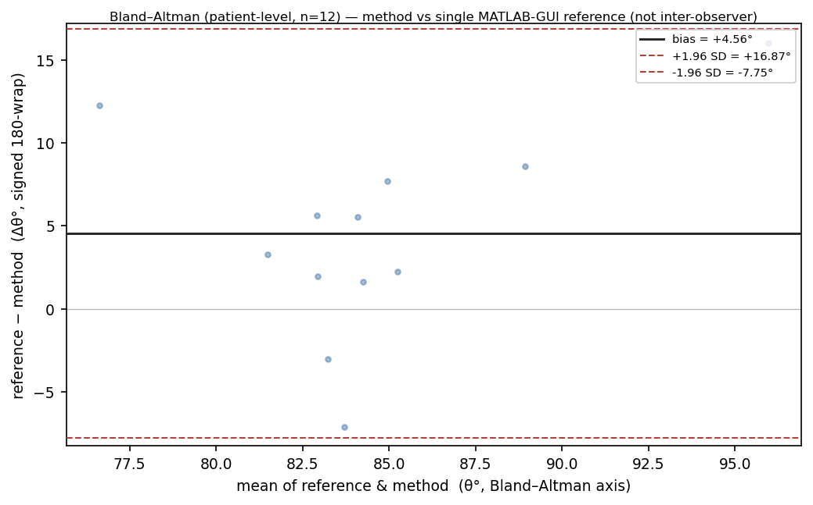
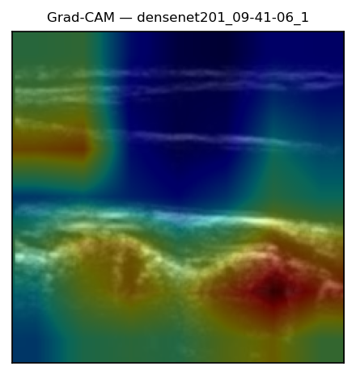

Published June 2021 &middot; revised January 2026 after a from-scratch re-run. Everything below describes that re-run and reports its numbers. The tooling is the re-run's (Keras&nbsp;3, JAX, Optuna, split-conformal intervals), and several things in it postdate June 2021: Keras&nbsp;3, the Apple M4 Max it ran on, the ConvNeXt encoders in the bake-off, DINOv2, and the 2025 preprint linked underneath.

[Code](https://github.com/nilesh-patil/ultrasound-doppler-angle-estimation) &middot; [Preprint](https://arxiv.org/abs/2508.04243) &middot; [EMBC 2019 paper](https://doi.org/10.1109/EMBC.2019.8857587) &middot; [Project site]({{ site.baseurl }}/portfolio/ultrasound-doppler-angle-estimation/)

## A few degrees decide the diagnosis

A spectral-Doppler study reports a blood velocity. That number is only as good as one angle a sonographer sets by hand on every single exam: the angle between the ultrasound beam and the direction of flow. Get it a few degrees off near the steep part of the curve and the reported velocity is wrong by tens of percent, enough to push a borderline carotid stenosis into the wrong grade. Angle correction is one of the things vascular-lab accreditation reviews scrutinize.

The cost of that hand-set angle is not linear. Blood velocity comes out of the Doppler equation,

$$f_d = \frac{2 f_0 v \cos\theta}{c}$$

where $\theta$ is the angle between the ultrasound beam and the direction of flow. The $\cos\theta$ sits on top of the velocity, so a small error in $\theta$ rides straight through: $v$ scales as $1/\cos\theta$, and the fractional velocity error per radian of angle error is $\tan\theta$, which is why it explodes past 70 degrees. A degree or two of angle error sounds negligible until you drag the slider below.

<figure>
 <svg id="dop-svg" viewBox="0 0 640 320" role="img" aria-labelledby="dop-t dop-d" style="width:100%;height:auto;max-width:640px;color:inherit" xmlns="http://www.w3.org/2000/svg">
 <title id="dop-t">How reported velocity scales with the Doppler angle</title>
 <desc id="dop-d">Left: a carotid vessel drawn as a horizontal lozenge with an ultrasound beam crossing it at an angle theta. Right: the curve of velocity multiplier one over cosine theta, with a moving dot at the current angle and a dashed reference line at sixty degrees. As theta rises toward seventy to seventy-eight degrees the curve climbs steeply, so the reported velocity runs away from the true value.</desc>
 <g stroke="currentColor" stroke-width="1.4" fill="none">
 <!-- vessel lozenge -->
 <rect x="34" y="150" width="210" height="36" rx="18" opacity="0.55"></rect>
 <!-- beam line, rotated about pivot (244,168) via JS -->
 <line id="dop-beam" x1="244" y1="168" x2="120" y2="46"></line>
 <!-- flow axis reference -->
 <line x1="34" y1="168" x2="244" y2="168" stroke-dasharray="4 4" opacity="0.45"></line>
 <!-- angle arc -->
 <path id="dop-arc" d="" opacity="0.7"></path>
 <!-- plot axes -->
 <line x1="330" y1="288" x2="624" y2="288" opacity="0.6"></line>
 <line x1="330" y1="40" x2="330" y2="288" opacity="0.6"></line>
 <!-- reference dashed line at theta = 60 -->
 <line id="dop-ref" x1="330" y1="0" x2="624" y2="0" stroke-dasharray="5 4" opacity="0.4"></line>
 <!-- the 1/cos curve -->
 <path id="dop-curve" d="" stroke-width="1.8"></path>
 </g>
 <g fill="currentColor" font-family="-apple-system, system-ui, sans-serif" aria-hidden="true">
 <text id="dop-theta-lbl" x="150" y="120" font-size="13" font-style="italic" text-anchor="middle">&#952;</text>
 <text x="139" y="200" font-size="11" opacity="0.7" text-anchor="middle">flow axis</text>
 <text x="139" y="142" font-size="11" opacity="0.7" text-anchor="middle">beam</text>
 <text x="477" y="306" font-size="11" opacity="0.7" text-anchor="middle">beam-to-flow angle &#952; (degrees)</text>
 <text x="318" y="48" font-size="11" opacity="0.7" text-anchor="end">5&#215;</text>
 <text x="318" y="288" font-size="11" opacity="0.7" text-anchor="end">1&#215;</text>
 </g>
 </svg>
 

 <label for="dop-range" style="display:block;font-size:0.85rem;opacity:0.75;margin:0.2rem 0">Drag the beam-to-flow angle</label>
 <input id="dop-range" type="range" min="30" max="78" step="1" value="60" style="width:100%;max-width:640px;accent-color:var(--global-base-color)">
 
&#952; = 60&deg; &nbsp;|&nbsp; velocity &#215;2.00 &nbsp;|&nbsp; error if the true angle is 60&deg; = +0%

 

 <figcaption>The dot marks the velocity multiplier $1/\cos\theta$ at the slider angle, and the dashed line is the 60 degree reading. Past 70 the curve goes near-vertical, which is why vascular labs are told to keep $\theta$ at or below 60.</figcaption>
</figure>

Near 60 degrees, each extra degree of angle moves the reported velocity by about 3%.

The alternative to a hand-set angle is one read off the image. [Patil &amp; Anand (EMBC 2019)](https://doi.org/10.1109/EMBC.2019.8857587) showed a convolutional network can regress the Doppler angle straight from a single grayscale B-mode frame of the carotid, with no color Doppler and no segmentation, and reported under 3&deg; mean error. I first-authored that paper. Seven years on I rebuilt the pipeline from scratch. The rebuild is Keras 3 on JAX, run on an Apple M4 Max, over the same cohort: 84 carotid images from 10 volunteers on one scanner.

## Labels from rotation {#labels}

The cohort has no clinical angle annotation, so $\theta$ was hand-drawn once per image in a MATLAB GUI. That single reading per base image is the only ground truth. To turn 84 readings into a regression corpus, each base image is rotated through $[-60°, +60°]$ in 5-degree steps, 25 oriented views apiece, for $84 \times 25 = 2{,}100$ labelled views. The label of a rotated view is exact: the new angle is the base angle plus the rotation. Because the increment is exact, the network learns to read relative image orientation.

The 2,100 views are 25 geometrically coupled copies of each of 84 base images, drawn from 10 volunteers: a three-level hierarchy of volunteer, base image, and rotated view. They cannot be scored as 2,100 independent observations.

## Two ways to score {#two-protocols}

Image-level sampling is the paper's protocol: split at random over the 2,100 augmented rows, which measures how well the estimator interpolates across the full population of orientations. Patient-level sampling holds out whole patient groups using GroupKFold over patient id. The test anatomy is then unseen at any rotation. It is the stricter, cross-subject score.

<figure>
 <svg viewBox="0 0 380 212" role="img" aria-labelledby="prot-t prot-d" style="width:100%;height:auto;max-width:420px;color:inherit" xmlns="http://www.w3.org/2000/svg">
 <title id="prot-t">Image-level versus patient-level splitting of the augmented corpus</title>
 <desc id="prot-d">The corpus is drawn as ten volunteer blocks, each holding a few base images and their rotation views. Under image-level splitting the held-out cells scatter across every block, including blocks that also contribute training rows. Under patient-level splitting whole volunteer blocks are held out, so no rotation of a test patient appears in training.</desc>
 <g id="prot-cells" stroke="currentColor" stroke-width="0.7"></g>
 <g id="prot-blocks" stroke="currentColor" stroke-width="1.2" fill="none"></g>
 <g fill="currentColor" font-family="-apple-system, system-ui, sans-serif" aria-hidden="true">
 <text id="prot-vol-lbl" x="0" y="0" font-size="10.5" opacity="0.7" text-anchor="start"></text>
 </g>
 </svg>
 

 <button id="prot-btn-img" type="button" role="radio" aria-checked="true" style="font:inherit;font-size:0.9rem;padding:0.4em 0.9em;border-radius:8px 0 0 8px;border:1px solid color-mix(in srgb, currentColor 30%, transparent);background:color-mix(in srgb, currentColor 22%, transparent);color:inherit;cursor:pointer">Image-level split</button><button id="prot-btn-pat" type="button" role="radio" aria-checked="false" style="font:inherit;font-size:0.9rem;padding:0.4em 0.9em;border-radius:0 8px 8px 0;border:1px solid color-mix(in srgb, currentColor 30%, transparent);border-left:none;background:color-mix(in srgb, currentColor 6%, transparent);color:inherit;cursor:pointer">Patient-level split</button>
 
Image-level: held-out rows scatter across every volunteer, interpolating across orientations. Tuned ensemble: 2.79% MAPE / 1.96&deg;.

 

 <figcaption>Held-out cells are drawn at lower opacity with a dashed outline. The ten blocks are schematic.</figcaption>
</figure>

The patient groups are 12 time-clustered proxies recovered by clustering acquisition timestamps, and they have not been verified as subject identities.[^groups] That is 12 groups for 10 volunteers, so the groups cannot match the volunteers one to one.

## The pooling head {#pooling}

My first frozen-feature runs landed near 14% MAPE (mean absolute percentage error) on a single augmented split. That looks like frozen features falling short of fine-tuned accuracy.

<figure>
 <svg viewBox="0 0 680 300" role="img" aria-labelledby="gap-t gap-d" style="width:100%;height:auto;max-width:680px;color:inherit" xmlns="http://www.w3.org/2000/svg">
 <title id="gap-t">Why global average pooling destroys the orientation signal and grid pooling keeps it</title>
 <desc id="gap-d">A six by six feature map carries a bright diagonal stripe of activation standing for the vessel. Global average pooling collapses it to a single short row of bars that does not change when the vessel rotates. Grid pooling instead averages onto a two by two block whose populated cells move to the mirror corner when the vessel rotates, so the layout still carries orientation.</desc>
 <defs>
 <marker id="gap-ah" viewBox="0 0 10 10" refX="8.5" refY="5" markerWidth="7" markerHeight="7" orient="auto-start-reverse">
 <path d="M0,0 L10,5 L0,10 z" fill="currentColor"></path>
 </marker>
 </defs>
 <!-- feature map cells filled by JS -->
 <g id="gap-map" stroke="currentColor" stroke-width="0.8"></g>
 <!-- GAP bars filled by JS -->
 <g id="gap-bars" stroke="currentColor" stroke-width="0.8"></g>
 <!-- grid pooling 2x2 filled by JS -->
 <g id="gap-grid" stroke="currentColor" stroke-width="0.8"></g>
 <g stroke="currentColor" stroke-width="1.4" fill="none">
 <path d="M196,150 L236,150" marker-end="url(#gap-ah)"></path>
 <path d="M196,150 L236,150" marker-end="url(#gap-ah)" opacity="0"></path>
 <path d="M450,150 L490,150" marker-end="url(#gap-ah)"></path>
 </g>
 <g fill="currentColor" font-family="-apple-system, system-ui, sans-serif" text-anchor="middle" aria-hidden="true">
 <text x="100" y="36" font-size="13" font-weight="600">feature map</text>
 <text x="100" y="278" font-size="11" opacity="0.7">vessel = diagonal stripe</text>
 <text x="338" y="36" font-size="13" font-weight="600">GAP</text>
 <text x="338" y="278" font-size="11" opacity="0.7">rotation-insensitive</text>
 <text x="585" y="36" font-size="13" font-weight="600">grid pooling (G&#215;G)</text>
 <text x="585" y="278" font-size="11" opacity="0.7">keeps coarse location</text>
 </g>
 </svg>
 

 <button id="gap-btn" type="button" aria-pressed="false" style="font:inherit;font-size:0.9rem;padding:0.4em 0.9em;border-radius:8px;border:1px solid color-mix(in srgb, currentColor 30%, transparent);background:color-mix(in srgb, currentColor 6%, transparent);color:inherit;cursor:pointer">Rotate vessel</button>
 

 <figcaption>Press the button to rotate the vessel: the GAP bars do not move, while the populated cells of the grid block swap corners. Brighter cells mean stronger activation. Cross-validated on frozen DenseNet201, GAP scores 10.85% image-level MAPE and grid pooling 4.58%; patient-level, 18.70% versus 12.59%.</figcaption>
</figure>

The culprit was the pooling. Global average pooling collapses an $(H, W, C)$ feature map to a length-$C$ vector by averaging each channel over every spatial position; average out where a channel fired and you keep only how much it fired, which is roughly invariant to rotating the image. For classification you want that invariance. Here the target *is* the vessel's orientation, encoded in the spatial layout of the activations, so GAP averages away the signal the model has to read.

Grid pooling keeps it. Instead of collapsing to one vector, average-pool the final feature map onto a coarse $G \times G$ grid, then flatten; a top-left cell is no longer interchangeable with a bottom-right one, so the flattened vector carries coarse spatial location and the head can read orientation off it. On a single augmented split, frozen DenseNet201 with grid pooling reaches 5.84% MAPE, 3.77&deg; MAE, $R^2$ 0.982, with no fine-tuning at all. That is close to the EMBC-2019 best single model (about 2.87&deg; / 4.03%), though it does not match that number until the head is tuned.[^grid]

## The climb: tuning, then ensembling {#climb}

The first thing I tried for more accuracy was a newer encoder. A frozen-feature bake-off across the modern zoo, with DenseNet201 pooled on a 3&times;3 grid and the newer encoders on 2&times;2, leaves DenseNet201 (14.13% patient MAPE) below ConvNeXt-Base (15.65%), ConvNeXt-Tiny (16.07%), and the EfficientNet / V2 family (roughly 17-21%). That 14.13% is the bake-off entry; a separate run of the same frozen DenseNet201, also on the 3&times;3 grid, reads 12.59% patient-level in the pooling and climb figures. With only 84 base images the ranking is empirical: the older frozen feature space happens to encode the orientation cue better.

<figure>
 <svg viewBox="0 0 680 365" role="img" aria-labelledby="bake-t bake-d" style="width:100%;height:auto;max-width:680px;color:inherit" xmlns="http://www.w3.org/2000/svg">
 <title id="bake-t">Frozen-backbone bake-off: patient-level MAPE per encoder</title>
 <desc id="bake-d">Horizontal bar chart of patient-level five-fold MAPE for eleven frozen backbones, lower is better. DenseNet201 is shortest at 14.13 percent and is highlighted; ConvNeXt-Base 15.65, ConvNeXt-Tiny 16.07, and the EfficientNet and EfficientNetV2 family sit between 17 and 21 percent.</desc>
 <line x1="168" y1="42" x2="168" y2="319" stroke="currentColor" stroke-width="1" opacity="0.35"></line>
 <g fill="currentColor" font-family="-apple-system, system-ui, sans-serif">
 <text x="160" y="61.0" font-size="11.5" text-anchor="end" font-weight="600">DenseNet201</text>
 <rect x="168" y="50" width="301.9" height="15" rx="2" fill="currentColor" fill-opacity="0.85"></rect>
 <text x="475.9" y="61.0" font-size="11" opacity="0.75">14.13</text>
 <text x="160" y="86.0" font-size="11.5" text-anchor="end">ConvNeXt-Base</text>
 <rect x="168" y="75" width="334.3" height="15" rx="2" fill="currentColor" fill-opacity="0.32"></rect>
 <text x="508.3" y="86.0" font-size="11" opacity="0.75">15.65</text>
 <text x="160" y="111.0" font-size="11.5" text-anchor="end">ConvNeXt-Tiny</text>
 <rect x="168" y="100" width="343.3" height="15" rx="2" fill="currentColor" fill-opacity="0.32"></rect>
 <text x="517.3" y="111.0" font-size="11" opacity="0.75">16.07</text>
 <text x="160" y="136.0" font-size="11.5" text-anchor="end">EfficientNetV2-B1</text>
 <rect x="168" y="125" width="368.1" height="15" rx="2" fill="currentColor" fill-opacity="0.32"></rect>
 <text x="542.1" y="136.0" font-size="11" opacity="0.75">17.23</text>
 <text x="160" y="161.0" font-size="11.5" text-anchor="end">EfficientNetV2-B2</text>
 <rect x="168" y="150" width="383.3" height="15" rx="2" fill="currentColor" fill-opacity="0.32"></rect>
 <text x="557.3" y="161.0" font-size="11" opacity="0.75">17.94</text>
 <text x="160" y="186.0" font-size="11.5" text-anchor="end">EfficientNet-B3</text>
 <rect x="168" y="175" width="384.8" height="15" rx="2" fill="currentColor" fill-opacity="0.32"></rect>
 <text x="558.8" y="186.0" font-size="11" opacity="0.75">18.01</text>
 <text x="160" y="211.0" font-size="11.5" text-anchor="end">EfficientNetV2-B0</text>
 <rect x="168" y="200" width="391.2" height="15" rx="2" fill="currentColor" fill-opacity="0.32"></rect>
 <text x="565.2" y="211.0" font-size="11" opacity="0.75">18.31</text>
 <text x="160" y="236.0" font-size="11.5" text-anchor="end">EfficientNet-B0</text>
 <rect x="168" y="225" width="393.1" height="15" rx="2" fill="currentColor" fill-opacity="0.32"></rect>
 <text x="567.1" y="236.0" font-size="11" opacity="0.75">18.40</text>
 <text x="160" y="261.0" font-size="11.5" text-anchor="end">EfficientNet-B1</text>
 <rect x="168" y="250" width="412.7" height="15" rx="2" fill="currentColor" fill-opacity="0.32"></rect>
 <text x="586.7" y="261.0" font-size="11" opacity="0.75">19.32</text>
 <text x="160" y="286.0" font-size="11.5" text-anchor="end">EfficientNetV2-B3</text>
 <rect x="168" y="275" width="417.2" height="15" rx="2" fill="currentColor" fill-opacity="0.32"></rect>
 <text x="591.2" y="286.0" font-size="11" opacity="0.75">19.53</text>
 <text x="160" y="311.0" font-size="11.5" text-anchor="end">EfficientNet-B2</text>
 <rect x="168" y="300" width="454.0" height="15" rx="2" fill="currentColor" fill-opacity="0.32"></rect>
 <text x="628.0" y="311.0" font-size="11" opacity="0.75">21.25</text>
 <text x="168" y="347" font-size="11" opacity="0.7">patient-level MAPE (%), frozen features, 5-fold CV - lower is better</text>
 </g>
 </svg>
 <figcaption>Patient-level 5-fold MAPE per frozen encoder; shorter bars are better.</figcaption>
</figure>

An Optuna TPE search over the head and optimizer, run on cached frozen features, moves single-model DenseNet201 from 4.58 to 4.03% image-level and 12.59 to 10.80% patient-level in the search's own validation (10.14% when re-scored on pooled out-of-fold predictions, the protocol the figure below uses).[^anchor] The gain is real but small, and 4.03% is where the from-scratch build finally matches the paper. These tuned single-model figures are in-sample to the search, so read them as optimistic. Each trial is a shallow head fit. One feature extraction per backbone serves both protocols, and no GPU is needed.

Stacking the five tuned backbones (DenseNet201, VGG19, ResNet50, Xception, InceptionV3) moves the numbers more. A Ridge meta-learner on pooled out-of-fold predictions reaches 2.79% / 1.96&deg; image-level and 8.53% / 5.93&deg; patient-level. That is the first configuration below 10% MAPE cross-patient. Read against its like-for-like predecessor, the single tuned DenseNet201 on pooled OOF (7.80&deg; / 10.14% patient-level), the ensembling gain is about 1.9&deg;. The plain mean of the same five lands at 9.89% patient-level. Before tuning it was a useless 21.9%, so what tuning did for the mean was calibrate the members just enough for averaging to help.

<figure>
 <svg viewBox="0 0 600 300" role="img" aria-labelledby="climb-t climb-d" style="width:100%;height:auto;max-width:600px;color:inherit" xmlns="http://www.w3.org/2000/svg">
 <title id="climb-t">MAPE descending from the core model to tuned single model to stacked ensemble</title>
 <desc id="climb-d">Two descending lines on a MAPE axis across three stages. The solid line is image-level: core model 5.84, tuned 4.03, ensemble 2.79. The dashed line is patient-level: core model 12.59, tuned 10.14, ensemble 8.53. The patient line stays well above the image line, and the vertical gap at the ensemble stage is the roughly three-fold spread.</desc>
 <g stroke="currentColor" stroke-width="1" fill="none" opacity="0.5">
 <line x1="70" y1="250" x2="560" y2="250"></line>
 <line x1="70" y1="40" x2="70" y2="250"></line>
 </g>
 <!-- patient line (dashed): rep 12.59 tuned 10.14 ens 8.53 ; map MAPE 14->40px, 0->250px linear: y=250-(v/14)*210 -->
 <g stroke="currentColor" fill="none">
 <polyline points="160,61.1 340,97.9 520,122.0" stroke-width="2" stroke-dasharray="6 4"></polyline>
 <polyline points="160,162.4 340,189.5 520,208.2" stroke-width="2"></polyline>
 </g>
 <g fill="currentColor" stroke="none">
 <circle cx="160" cy="61.1" r="3.2"></circle><circle cx="340" cy="97.9" r="3.2"></circle><circle cx="520" cy="122.0" r="3.2"></circle>
 <circle cx="160" cy="162.4" r="3.2"></circle><circle cx="340" cy="189.5" r="3.2"></circle><circle cx="520" cy="208.2" r="3.2"></circle>
 </g>
 <g fill="currentColor" font-family="-apple-system, system-ui, sans-serif" font-size="11.5" text-anchor="middle" aria-hidden="true">
 <text x="160" y="280">Core model</text>
 <text x="340" y="280">Tuned</text>
 <text x="520" y="280">Ensemble</text>
 <text x="160" y="50">12.59</text><text x="340" y="87">10.14</text><text x="520" y="111">8.53</text>
 <text x="160" y="178">5.84</text><text x="340" y="205">4.03</text><text x="520" y="224">2.79</text>
 <text x="540" y="116" font-size="10.5" opacity="0.75" text-anchor="start">patient</text>
 <text x="540" y="203" font-size="10.5" opacity="0.75" text-anchor="start">image</text>
 <text x="38" y="46" font-size="10.5" opacity="0.7" text-anchor="end">MAPE</text>
 <text x="520" y="146" font-size="10" opacity="0.75">below 10% cross-patient</text>
 </g>
 </svg>
 <figcaption>The dashed line is patient-level, the solid line image-level. The first image-level point is the single-split 5.84%; cross-validated, that model scores 4.58%.</figcaption>
</figure>

The gap between the two lines at the ensemble stage is the 3-fold image-versus-patient spread. That spread measures how much of the within-population accuracy is specific to anatomy the model has already seen.

Rotation test-time augmentation buys accuracy without retraining. The 25 views of a frame get de-rotated back to base and reduced circularly (180-periodic, seam-safe so a straddle of the 0/180 wrap does not corrupt the average), which cuts base-image MAE from 7.80&deg; to 4.72&deg; with the circular median, about a 40% cut. It costs 25 forward passes per image. Both numbers are for the single tuned DenseNet201, so they do not compare directly with the ensemble's 5.93&deg;.

## A number needs a band {#clinical}

The checks in this section were also run on the single tuned DenseNet201.

Split-conformal calibration, with a patient-disjoint calibration set, gives a 90% band of &plusmn;20.5&deg; at 95.2% empirical coverage. That is wide, roughly 41 degrees in total. Distribution-free validity costs that much on a cohort this size. A conformal interval covers the truth at a stated rate without assuming a noise model, and here coverage sits at or above nominal, so the band is conservative if anything. The 95.2% comes from one seed-42 patient-disjoint split.

<figure>
 <svg viewBox="0 0 460 380" role="img" aria-labelledby="cal-t cal-d" style="width:100%;height:auto;max-width:460px;color:inherit" xmlns="http://www.w3.org/2000/svg">
 <title id="cal-t">Split-conformal calibration: empirical vs nominal coverage</title>
 <desc id="cal-d">Empirical coverage plotted against nominal level. The dashed diagonal is perfect calibration. Three points sit on or above it: nominal 80 gives 89.7 percent empirical, nominal 90 gives 95.2 percent, nominal 95 gives 97.8 percent, so the intervals are valid rather than optimistic.</desc>
 <rect x="74" y="44" width="346" height="282" fill="currentColor" opacity="0.04"></rect>
 <line x1="74.0" y1="326.0" x2="420.0" y2="44.0" stroke="currentColor" stroke-dasharray="5 4" opacity="0.5"></line>
 <polyline points="143.2,160.2 281.6,98.1 350.8,68.8" fill="none" stroke="currentColor" stroke-width="1.6" opacity="0.55"></polyline>
 <g stroke="currentColor">
 <line x1="74" y1="44" x2="74" y2="326" opacity="0.5"></line>
 <line x1="74" y1="326" x2="420" y2="326" opacity="0.5"></line>
 </g>
 <g fill="currentColor" font-family="-apple-system, system-ui, sans-serif"><line x1="143.2" y1="326" x2="143.2" y2="330" stroke="currentColor" opacity="0.5"></line><text x="143.2" y="344" font-size="10.5" text-anchor="middle" opacity="0.7">80</text><line x1="212.4" y1="326" x2="212.4" y2="330" stroke="currentColor" opacity="0.5"></line><text x="212.4" y="344" font-size="10.5" text-anchor="middle" opacity="0.7">85</text><line x1="281.6" y1="326" x2="281.6" y2="330" stroke="currentColor" opacity="0.5"></line><text x="281.6" y="344" font-size="10.5" text-anchor="middle" opacity="0.7">90</text><line x1="350.8" y1="326" x2="350.8" y2="330" stroke="currentColor" opacity="0.5"></line><text x="350.8" y="344" font-size="10.5" text-anchor="middle" opacity="0.7">95</text><line x1="420.0" y1="326" x2="420.0" y2="330" stroke="currentColor" opacity="0.5"></line><text x="420.0" y="344" font-size="10.5" text-anchor="middle" opacity="0.7">100</text><line x1="70" y1="269.6" x2="74" y2="269.6" stroke="currentColor" opacity="0.5"></line><text x="66" y="273.1" font-size="10.5" text-anchor="end" opacity="0.7">80</text><line x1="70" y1="213.2" x2="74" y2="213.2" stroke="currentColor" opacity="0.5"></line><text x="66" y="216.7" font-size="10.5" text-anchor="end" opacity="0.7">85</text><line x1="70" y1="156.8" x2="74" y2="156.8" stroke="currentColor" opacity="0.5"></line><text x="66" y="160.3" font-size="10.5" text-anchor="end" opacity="0.7">90</text><line x1="70" y1="100.4" x2="74" y2="100.4" stroke="currentColor" opacity="0.5"></line><text x="66" y="103.9" font-size="10.5" text-anchor="end" opacity="0.7">95</text><line x1="70" y1="44.0" x2="74" y2="44.0" stroke="currentColor" opacity="0.5"></line><text x="66" y="47.5" font-size="10.5" text-anchor="end" opacity="0.7">100</text><circle cx="143.2" cy="160.2" r="4.2" fill="currentColor"></circle><text x="151.2" y="154.2" font-size="11" font-weight="600">89.7%</text><circle cx="281.6" cy="98.1" r="4.2" fill="currentColor"></circle><text x="289.6" y="92.1" font-size="11" font-weight="600">95.2%</text><circle cx="350.8" cy="68.8" r="4.2" fill="currentColor"></circle><text x="358.8" y="62.8" font-size="11" font-weight="600">97.8%</text>
 <text x="247" y="360" font-size="11.5" text-anchor="middle" opacity="0.8">nominal coverage (%)</text>
 <text x="18" y="185" font-size="11.5" text-anchor="middle" opacity="0.8" transform="rotate(-90 18 185)">empirical coverage (%)</text>
 <text x="171" y="292" font-size="10.5" opacity="0.6">diagonal = perfect calibration</text>
 </g>
 </svg>
 <figcaption>Empirical coverage against nominal level at 80, 90, and 95%.</figcaption>
</figure>

Agreement comes from a Bland-Altman plot against the single MATLAB-GUI reference reading: the model's per-sample bias is about 4.3&deg; below the reference. Averaged per patient group, as plotted, it is 4.56&deg;. With exactly one human reading per image, this measures method against reference.

<figure>
 
 <figcaption>Reference minus model angle against their mean, one point per patient group, with the bias line and the 95% limits of agreement.</figcaption>
</figure>

Grad-CAM lands on the carotid wall, the boundary that fixes the flow axis.

<figure>
 
 <figcaption>Grad-CAM over a carotid B-mode frame; warm colours are high activation. One of three hand-picked frames.</figcaption>
</figure>

## Where it reaches next, and where the ceiling is {#limits}

The obvious successors to a frozen ImageNet backbone are modern self-supervised encoders, DINOv2 or a medical-ultrasound foundation model, but they need a CUDA box and a reworked dependency stack. A hand-crafted structure-tensor baseline (MAE 3.16&deg;) with a learned-plus-classical circular fusion (2.72&deg;) suggests the learned and geometric cues capture partly complementary signal. Both figures are in-sample on the 84 unrotated base images, a narrow base-angle band. On the same 84 frames the single tuned DenseNet201 reads 3.20&deg; MAE out of fold at image level and 5.08&deg; at patient level.

End-to-end fine-tuning of the strong backbones OOMs the Apple GPU even at batch 16. That is a limit of this machine. A from-scratch CNN fails outright (MAPE around 101%, negative $R^2$).

[Try the angle dial](#dop-svg){: .btn-soft .btn-soft--primary} [Project site]({{ site.baseurl }}/portfolio/ultrasound-doppler-angle-estimation/){: .btn-soft} [Browse the code](https://github.com/nilesh-patil/ultrasound-doppler-angle-estimation){: .btn-soft}

[^grid]: DenseNet201 uses a 3&times;3 grid; the other four classic backbones use 2&times;2. The choice falls out of each backbone's config.
[^groups]: GroupKFold then guarantees no proxy group straddles the train/test boundary, which is the property that matters even if the group labels are imperfect.
[^anchor]: Both lines mix estimators by stage: the 5.84% and 12.59% core-model points are single-split and per-fold-mean figures, while the tuned (4.03% / 10.14%) and ensemble (2.79% / 8.53%) points are CV or pooled-OOF means. Stacking on pooled OOF over 12 groups is itself mildly optimistic.

