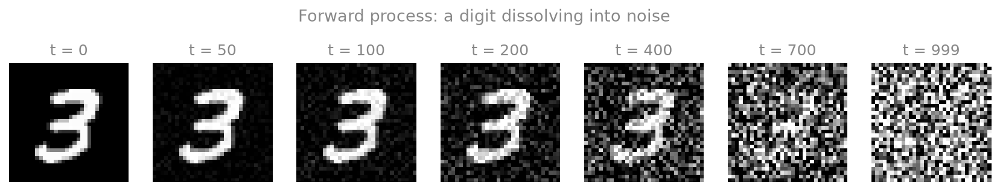
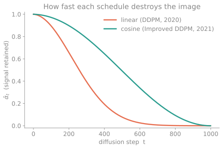
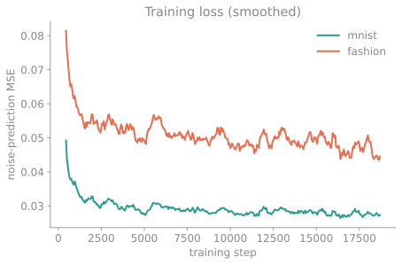
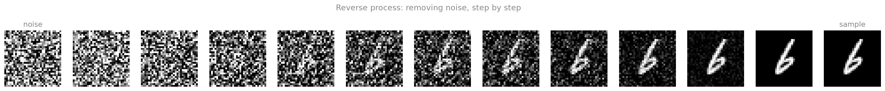
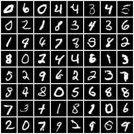
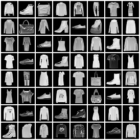
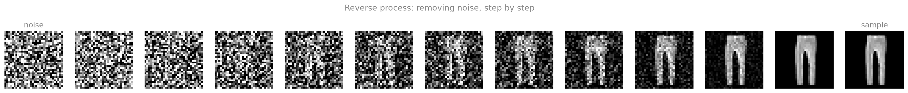
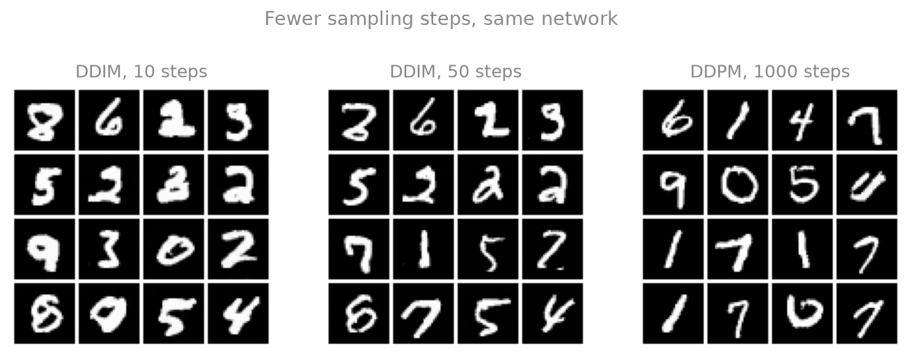
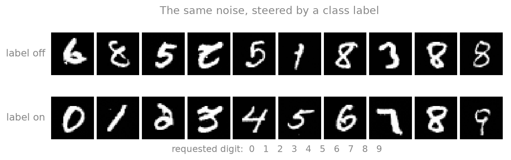
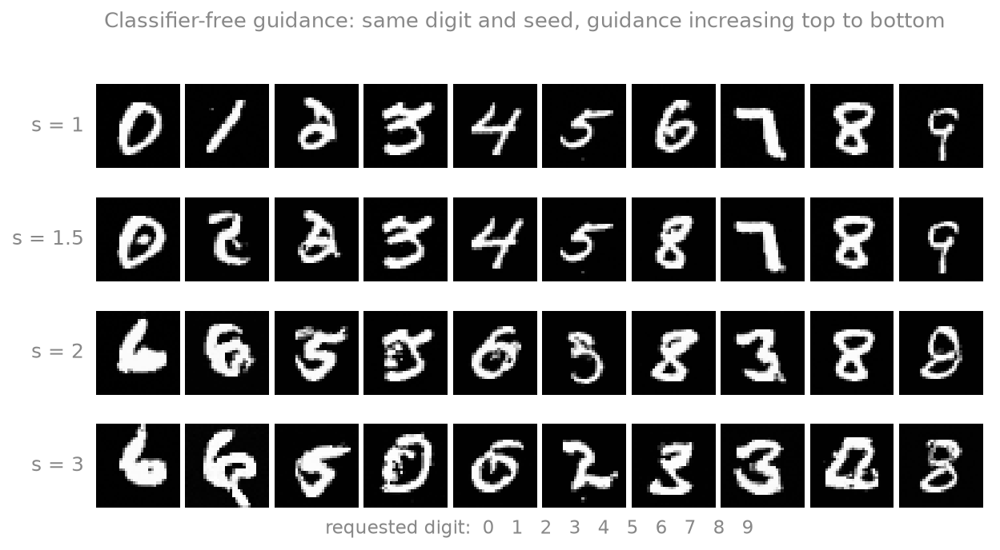

Every digit in the sample grid further down this post started as pure static. A small neural network looked at random noise and, step by step, removed its way to a handwritten number. You can replicate the full exercise locally: the model package is a bit over five hundred lines of PyTorch, and the training script adds about a hundred more.

A diffusion model is a [generative model](https://openai.com/index/generative-models/) that learns to reverse a gradual noising process. You take real data, destroy it by adding noise in small steps until nothing is left, and train a network to undo one step of that destruction. To generate something new, you hand the network pure noise and let it walk the destruction backwards. As of May 2022 this produces the best image samples the field has: a year ago [diffusion overtook the strongest GANs on ImageNet](https://arxiv.org/abs/2105.05233) (Dhariwal and Nichol), and the two text-to-image systems of the last six months, GLIDE and DALL·E 2, are both built on it.

I am writing this three weeks after the [DALL·E 2](https://arxiv.org/abs/2204.06125) paper went up, and a month after OpenAI first showed it off. You write a caption like "Picard riding on Voyager, through Delta Quadrant's unique planets" and the model paints it. Those results run on the same denoising loop I build below, first on MNIST digits and then on Fashion-MNIST clothing. The papers that carried it from "interesting on CIFAR" to DALL·E 2 were nearly all published between 2020 and last month, and I go through them after the build.
The companion code is at [`ddpm-from-scratch`](https://github.com/nilesh-patil/ddpm-from-scratch). Every plot and sample grid below comes out of it.

## The whole idea in one picture

Two processes run in opposite directions.

The **forward process** takes a clean image and adds a small amount of Gaussian noise, then a little more, for $T$ steps, until the image is indistinguishable from static. Nothing in it is learned: how much noise to add at each step is fixed before training starts, and the noise itself is drawn fresh at random.

The **reverse process** is a neural network. It learns to look at a noisy image and undo one step of the forward process, and applying it a thousand times in a row is what gets us from static back to a plausible image.

<figure>
  <svg viewBox="0 0 640 214" role="img" aria-labelledby="chain-t chain-d" style="width:100%;height:auto;max-width:640px;color:inherit" xmlns="http://www.w3.org/2000/svg">
    <title id="chain-t">The forward and reverse diffusion chains</title>
    <desc id="chain-d">Five states in a row, from a clean image x-zero on the left to pure noise x-T on the right. Forward arrows along the top add a little Gaussian noise at each step and are fixed, with no learned parameters. Reverse arrows along the bottom remove noise one step at a time and are produced by a trained network.</desc>
    <defs>
      <marker id="chain-ah" viewBox="0 0 10 10" refX="8.5" refY="5" markerWidth="7" markerHeight="7" orient="auto-start-reverse">
        <path d="M0,0 L10,5 L0,10 z" fill="currentColor"></path>
      </marker>
    </defs>
    <g fill="none" stroke="currentColor" stroke-width="1.6">
      <rect x="36" y="74" width="56" height="56" rx="8"></rect>
      <rect x="164" y="74" width="56" height="56" rx="8" stroke-dasharray="7 3"></rect>
      <rect x="292" y="74" width="56" height="56" rx="8" stroke-dasharray="4 4"></rect>
      <rect x="420" y="74" width="56" height="56" rx="8" stroke-dasharray="2 5"></rect>
      <rect x="548" y="74" width="56" height="56" rx="8" stroke-dasharray="1 6"></rect>
    </g>
    <g fill="none" stroke="currentColor" stroke-width="1.4">
      <path d="M96,90 L160,90" marker-end="url(#chain-ah)"></path>
      <path d="M224,90 L288,90" marker-end="url(#chain-ah)"></path>
      <path d="M352,90 L416,90" marker-end="url(#chain-ah)"></path>
      <path d="M480,90 L544,90" marker-end="url(#chain-ah)"></path>
      <path d="M160,114 L96,114" marker-end="url(#chain-ah)" opacity="0.65"></path>
      <path d="M288,114 L224,114" marker-end="url(#chain-ah)" opacity="0.65"></path>
      <path d="M416,114 L352,114" marker-end="url(#chain-ah)" opacity="0.65"></path>
      <path d="M544,114 L480,114" marker-end="url(#chain-ah)" opacity="0.65"></path>
    </g>
    <g fill="currentColor" font-family="-apple-system, system-ui, sans-serif" text-anchor="middle" aria-hidden="true">
      <text x="320" y="26" font-size="13" font-weight="600">forward: add a little Gaussian noise &#183; fixed, no parameters</text>
      <text x="64" y="156" font-size="13">x&#8320;</text>
      <text x="192" y="156" font-size="13">x&#8321;</text>
      <text x="320" y="156" font-size="13">x&#8348;</text>
      <text x="448" y="156" font-size="13">&#8230;</text>
      <text x="576" y="156" font-size="13">x&#8348;</text>
      <text x="64" y="174" font-size="10.5" opacity="0.7">clean image</text>
      <text x="576" y="174" font-size="10.5" opacity="0.7">pure noise</text>
      <text x="320" y="202" font-size="13" font-weight="600">reverse: a network predicts the noise and removes it &#183; learned</text>
    </g>
  </svg>
  <figcaption>Top arrows, left to right: the fixed forward process, each step adding a little Gaussian noise (the box outlines go from solid to dotted as the image degrades). Bottom arrows, right to left: the learned reverse process, one network applied at every step.</figcaption>
</figure>

What makes this trainable on a laptop is that we don't ***have to*** run the forward process one step at a time during training: each step only adds Gaussian noise and Gaussians stack into Gaussians, so we can jump straight to the noise level at any step `t` in a single shot.

## Destroying an image by design

Let the noise schedule be a sequence of small numbers $\beta_1, \dots, \beta_T$ (I used $T = 1000$). Define $\alpha_t = 1 - \beta_t$, and let $\bar{\alpha}_t$ be the running product of every $\alpha$ up to step `t`:

$$\bar{\alpha}_t = \prod_{s=1}^{t} \alpha_s$$

Then the noised image at step `t`, given the clean image $x_0$, has a closed form:

$$x_t = \sqrt{\bar{\alpha}_t}\, x_0 + \sqrt{1 - \bar{\alpha}_t}\; \epsilon, \qquad \epsilon \sim \mathcal{N}(0, \mathbf{I})$$

Visualize it as a slider, i.e. $\bar{\alpha}_t$ starts near 1 and decays toward 0 as `t` grows, so early on you keep most of the image and add a whisper of noise, and late on you keep almost none of the image and it is nearly all noise. No network is involved yet. In code it is two lines:

```python
def q_sample(self, x0, t, noise):

    # jump straight to the noise level at step t ( reparameterization )

    A = extract(self.sqrt_alphas_cumprod, t, x0.shape) * x0
    B = extract(self.sqrt_one_minus_alphas_cumprod, t, x0.shape) * noise

    return ( A + B )
```

Below is a real `3` from MNIST, run through `q_sample` at seven increasing values of `t`.

<figure>
  
  <figcaption>The forward process on one digit: clean at t=0, indistinguishable from Gaussian noise by t=999. A good deal of structure survives even at t=400.</figcaption>
</figure>

How gradually the digit dissolves is set by the noise schedule, and the schedule was one of the first things changed after the original model. The [DDPM](https://arxiv.org/abs/2006.11239) paper used a **linear** schedule, where $\beta_t$ grows linearly. A year later, [Improved DDPM](https://arxiv.org/abs/2102.09672) pointed out that on small images the linear schedule destroys the picture too fast, so the last few hundred steps are nearly pure noise and teach the network almost nothing, and their **cosine** schedule, which keeps signal around for longer, is the one I use.

<figure>
  
  <figcaption>$\bar{\alpha}_t$, the fraction of the original signal retained, against diffusion step. The linear schedule (DDPM, 2020) is near zero by the two-thirds mark; the cosine schedule (Improved DDPM, 2021) keeps usable signal for almost the whole chain.</figcaption>
</figure>

## Training a network to undo one step

The network is the only learned part. Given a noisy image $x_t$ and the step `t`, it has to remove noise. It could predict either the clean image or the noise that was added; DDPM predicts **the noise**. So $\epsilon_\theta(x_t, t)$ guesses the $\epsilon$, and the loss is the mean squared error between the true noise and the guess.

$$L = \mathbb{E}_{t,\, x_0,\, \epsilon}\, \big\lVert\, \epsilon - \epsilon_\theta(x_t,\, t)\, \big\rVert^2$$

This simple form drops out of a variational bound on the data likelihood; the DDPM paper has the derivation. The training step is short:

```python
def p_losses(self, model, x0, t):
    noise = torch.randn_like(x0)            # the target
    x_t = self.q_sample(x0, t, noise)       # noise the image to level t
    predicted = model(x_t, t)               # ask the network to guess the noise
    return F.mse_loss(predicted, noise)     # how wrong was it
```

The full training loop is an ordinary supervised loop with one extra line that picks a random noise level per image:

```python
for x0, _ in dataloader:
    t = torch.randint(0, T, (x0.size(0),))   # a different noise level per image
    loss = diffusion.p_losses(model, x0, t)
    opt.zero_grad(); loss.backward(); opt.step()
    ema.update(model)                        # keep a moving average of the weights
```

About the `ema.update` line: sampling from an exponential moving average of the weights, in place of the live weights, noticeably cleans up the samples in my runs, and all it costs is a second copy of the parameters.

The network is a **U-Net** with one diffusion-specific addition: the step `t` becomes a sinusoidal embedding injected into every block, so one set of weights can behave differently at high noise and low noise. Mine is about 10M parameters. I won't walk through it line by line; the whole thing is in [`unet.py`](https://github.com/nilesh-patil/ddpm-from-scratch/blob/main/ddpm/unet.py), and the figure below has the shape.

<figure>
  <svg viewBox="0 0 720 364" role="img" aria-labelledby="unet-t unet-d" style="width:100%;height:auto;max-width:720px;color:inherit" xmlns="http://www.w3.org/2000/svg">
    <title id="unet-t">A U-Net for diffusion: encoder, bottleneck, decoder, skip connections, and timestep injection</title>
    <desc id="unet-d">A symmetric funnel read left to right. On the left a tall box is the noisy input image; boxes shrink in height step by step through the encoder as spatial resolution drops, reaching the smallest box at the centre, the bottleneck. Boxes then grow back to full height through the decoder, ending in the predicted-noise output on the right. Three arcs over the top are skip connections that link each encoder box to the decoder box at the same resolution, carrying fine detail straight across. At the bottom a single node holds the timestep t turned into a sinusoidal embedding, with faint lines fanning up into every box.</desc>
    <defs>
      <marker id="unet-ah" viewBox="0 0 10 10" refX="8.5" refY="5" markerWidth="7" markerHeight="7" orient="auto-start-reverse">
        <path d="M0,0 L10,5 L0,10 z" fill="currentColor"></path>
      </marker>
      <marker id="unet-ah-sm" viewBox="0 0 10 10" refX="8" refY="5" markerWidth="5" markerHeight="5" orient="auto-start-reverse">
        <path d="M0,0 L10,5 L0,10 z" fill="currentColor"></path>
      </marker>
    </defs>
    <g fill="none" stroke="currentColor" stroke-width="0.75">
      <path d="M60,110 C60,26 660,26 660,110" marker-end="url(#unet-ah)"></path>
      <path d="M160,129 C160,52 560,52 560,129" marker-end="url(#unet-ah)"></path>
      <path d="M260,145 C260,80 460,80 460,145" marker-end="url(#unet-ah)"></path>
    </g>
    <g fill="none" stroke="currentColor" stroke-width="1.6">
      <rect x="38" y="110" width="44" height="120" rx="5"></rect>
      <rect x="138" y="129" width="44" height="82" rx="5"></rect>
      <rect x="238" y="145" width="44" height="50" rx="5"></rect>
      <rect x="338" y="156" width="44" height="28" rx="5"></rect>
      <rect x="438" y="145" width="44" height="50" rx="5"></rect>
      <rect x="538" y="129" width="44" height="82" rx="5"></rect>
      <rect x="638" y="110" width="44" height="120" rx="5"></rect>
    </g>
    <g fill="none" stroke="currentColor" stroke-width="1.4">
      <path d="M84,170 L134,170" marker-end="url(#unet-ah)"></path>
      <path d="M184,170 L234,170" marker-end="url(#unet-ah)"></path>
      <path d="M284,170 L334,170" marker-end="url(#unet-ah)"></path>
      <path d="M384,170 L434,170" marker-end="url(#unet-ah)"></path>
      <path d="M484,170 L534,170" marker-end="url(#unet-ah)"></path>
      <path d="M584,170 L634,170" marker-end="url(#unet-ah)"></path>
    </g>
    <g fill="none" stroke="currentColor" stroke-width="0.8" opacity="0.34">
      <path d="M360,306 L60,231" marker-end="url(#unet-ah-sm)"></path>
      <path d="M360,306 L160,212" marker-end="url(#unet-ah-sm)"></path>
      <path d="M360,306 L260,196" marker-end="url(#unet-ah-sm)"></path>
      <path d="M360,306 L360,185" marker-end="url(#unet-ah-sm)"></path>
      <path d="M360,306 L460,196" marker-end="url(#unet-ah-sm)"></path>
      <path d="M360,306 L560,212" marker-end="url(#unet-ah-sm)"></path>
      <path d="M360,306 L660,231" marker-end="url(#unet-ah-sm)"></path>
    </g>
    <g fill="none" stroke="currentColor" stroke-width="1">
      <rect x="294" y="306" width="120" height="26" rx="12"></rect>
      <path d="M306,319 q5,-8 10,0 q5,8 10,0" stroke-width="1"></path>
    </g>
    <g fill="currentColor" font-family="-apple-system, system-ui, sans-serif" text-anchor="middle" aria-hidden="true">
      <text x="360" y="15" font-size="12.5" font-weight="600">skip connection &#183; fine detail carried straight across</text>
      <text x="210" y="161" font-size="10.5" opacity="0.72">encoder</text>
      <text x="510" y="161" font-size="10.5" opacity="0.72">decoder</text>
      <text x="360" y="126" font-size="11.5" font-weight="600">bottleneck</text>
      <text x="360" y="139" font-size="10" opacity="0.72">coarsest scale &#183; global structure</text>
      <text x="60" y="251" font-size="11.5">noisy image x&#8348;</text>
      <text x="60" y="265" font-size="10" opacity="0.7">input</text>
      <text x="660" y="251" font-size="11.5">predicted noise &#949;&#770;</text>
      <text x="660" y="265" font-size="10" opacity="0.7">output</text>
      <text x="334" y="323" font-size="11" text-anchor="start">step t</text>
      <text x="360" y="350" font-size="10.5" opacity="0.78">sinusoidal embedding, added into every block</text>
    </g>
  </svg>
  <figcaption>U-Net structure, read left to right: the encoder shrinks the image down to the bottleneck and the decoder grows it back into a full-resolution noise prediction. The arcs on top are skip connections between encoder and decoder blocks at the same resolution. The faint lines from the bottom are the embedding of the timestep <code>t</code> going into every block.</figcaption>
</figure>

Trained on MNIST for forty epochs, the loss falls fast and then crawls. The loss value is a poor proxy for sample quality here: the grids kept sharpening for many epochs after the number had stopped moving.

<figure>
  
  <figcaption>Noise-prediction MSE during training, smoothed. The second curve is the Fashion-MNIST run from a later section.</figcaption>
</figure>

## Sampling from pure noise

Training taught the network to undo one step, and sampling chains those steps. Start from pure Gaussian noise $x_T$, ask the network for the noise, form a slightly cleaner mean by subtracting it, add back fresh randomness scaled by the step's variance, and step down to $x_{t-1}$. That variance is fixed by the schedule here, and it is the `log_var` term in the code below; Improved DDPM later showed it can be learned instead. The fresh randomness is what keeps each run different, and if you drop it the reverse process turns deterministic, which DDIM makes use of further down. The reverse step in code, where the subtraction lives inside `p_mean_variance`:

```python
@torch.no_grad()
def p_sample(self, model, x_t, t):
    mean, log_var, _ = self.p_mean_variance(model, x_t, t)  # uses eps_theta
    noise = torch.randn_like(x_t)
    nonzero = (t != 0).float().reshape(-1, 1, 1, 1)          # no noise on the last step
    return mean + nonzero * (0.5 * log_var).exp() * noise
```

Run that from `t = 999` down to `t = 0` and an image condenses out of the static. This is the figure that made diffusion click for me: a single sample, captured every hundred steps as it resolves from noise into a legible handwritten digit.

<figure>
  
  <figcaption>One sample over the full reverse chain: the starting noise on the left, then a frame every hundred denoising steps. The rough shape of the digit is settled around the middle of the chain, and the late steps are mostly cleanup.</figcaption>
</figure>

Do the same for sixty-four independent noise seeds and you get a whole sheet of digits.

<figure>
  
  <figcaption>Sixty-four samples generated using our trained model</figcaption>
</figure>

## Retraining on clothes

I didn't believe the MNIST grid. Ten digit shapes is the kind of thing a small network can memorize outright, and the check that would settle it, a nearest-neighbour search of the samples against the training set, is one I have not run. What I did was re-run the identical code on clothes: I changed one command-line flag, `--dataset fashion`, retrained the same architecture on Fashion-MNIST, and touched nothing else. So the code has nothing tuned to digits in it, but whether the MNIST model memorized its training set is still an open question.

<figure>
  
  <figcaption>Fashion-MNIST samples from the same code with only the dataset flag changed. The textures (ribbing on a pullover, the sole of a shoe) are harder than digit strokes, and the model mostly gets them.</figcaption>
</figure>

<figure>
  
  <figcaption>The reverse process on clothing. The silhouette of each item commits early and the details fill in late, similar to digits.</figcaption>
</figure>

## Making it usable: DDIM and fewer steps

So far I have skipped over what sampling costs: the network runs a full thousand times to produce a single image. I can live with that for a few grids. A shortcut arrived within months of DDPM, in [DDIM](https://arxiv.org/abs/2010.02502) (Song, Meng, and Ermon, late 2020).

DDIM reuses the same trained weights with no retraining, and it reinterprets the reverse process so that the steps no longer have to form a Markov chain, which lets you skip most of them and, in its deterministic ($\eta = 0$) setting, makes the same starting noise map to the same image every time you run it. The per-step logic is "guess the clean image, then jump partway back toward it" (schematic):

```python
x0  = predict_clean_image(img, t, eps)                   # invert the forward equation
img = sqrt(abar_prev) * x0 + sqrt(1 - abar_prev) * eps   # re-noise to an earlier step
```

I sample in 50 steps instead of 1000, a 20x speedup, with barely any loss in quality that the eye can catch. Below, the same network sampled with 10, 50, and 1000 steps.

<figure>
  
  <figcaption>DDIM at 10 and 50 steps and DDPM at 1000 steps, all from the one trained network. The two DDIM panels share a starting seed, which is why the digit identities line up between them. The DDPM panel follows a different, stochastic path.</figcaption>
</figure>

The model above has no way to take a request. It never saw a label during training, so which digit comes out depends only on the starting noise, and conditioning changes that with one small addition: you hand the network a class label alongside the timestep, folded in as one more embedding exactly like `t`, and train it to denoise with the label available. The steering methods below all build on that, so I added it to my MNIST model and trained a conditional version, which the guidance section uses.

## How this became DALL·E 2

Everything above is the 2020 core: DDPM plus DDIM. Getting from there to the system that drew the astronaut on the horse took a handful of papers.

<figure>
  <svg viewBox="0 0 720 264" role="img" aria-labelledby="line-t line-d" style="width:100%;height:auto;max-width:720px;color:inherit" xmlns="http://www.w3.org/2000/svg">
    <title id="line-t">A timeline of diffusion model milestones from 2015 to 2022</title>
    <desc id="line-d">A horizontal time axis. Key milestones: 2015 the origin paper; 2019 score matching; 2020 DDPM makes it work and DDIM makes sampling fast; 2021 classifier guidance beats GANs, then classifier-free guidance, latent diffusion, and GLIDE arrive late in the year; April 2022 DALL-E 2. The events cluster more densely toward 2021 and 2022.</desc>
    <defs>
      <marker id="line-ah" viewBox="0 0 10 10" refX="8" refY="5" markerWidth="7" markerHeight="7" orient="auto">
        <path d="M0,0 L10,5 L0,10 z" fill="currentColor"></path>
      </marker>
    </defs>
    <line x1="32" y1="138" x2="694" y2="138" stroke="currentColor" stroke-width="1.6" marker-end="url(#line-ah)"></line>
    <g stroke="currentColor" stroke-width="1.3" fill="currentColor">
      <circle cx="64" cy="138" r="3.5"></circle>
      <circle cx="190" cy="138" r="3.5"></circle>
      <circle cx="300" cy="138" r="3.5"></circle>
      <circle cx="350" cy="138" r="3.5"></circle>
      <circle cx="470" cy="138" r="3.5"></circle>
      <circle cx="560" cy="138" r="3.5"></circle>
      <circle cx="650" cy="138" r="4.5" stroke-width="2"></circle>
    </g>
    <g stroke="currentColor" stroke-width="1" opacity="0.5">
      <line x1="64" y1="138" x2="64" y2="104"></line>
      <line x1="190" y1="138" x2="190" y2="172"></line>
      <line x1="300" y1="138" x2="300" y2="104"></line>
      <line x1="350" y1="138" x2="350" y2="172"></line>
      <line x1="470" y1="138" x2="470" y2="104"></line>
      <line x1="560" y1="138" x2="560" y2="172"></line>
      <line x1="650" y1="138" x2="650" y2="92"></line>
    </g>
    <g fill="currentColor" font-family="-apple-system, system-ui, sans-serif" text-anchor="middle" aria-hidden="true">
      <text x="64" y="96" font-size="11.5" font-weight="600">2015</text>
      <text x="64" y="83" font-size="10" opacity="0.75">origin</text>
      <text x="190" y="188" font-size="11.5" font-weight="600">2019</text>
      <text x="190" y="201" font-size="10" opacity="0.75">score matching</text>
      <text x="300" y="96" font-size="11.5" font-weight="600">2020 DDPM</text>
      <text x="300" y="83" font-size="10" opacity="0.75">it works</text>
      <text x="350" y="188" font-size="11.5" font-weight="600">2020 DDIM</text>
      <text x="350" y="201" font-size="10" opacity="0.75">fast sampling</text>
      <text x="470" y="96" font-size="11.5" font-weight="600">2021 guidance</text>
      <text x="470" y="83" font-size="10" opacity="0.75">beats GANs</text>
      <text x="560" y="188" font-size="11.5" font-weight="600">Dec 2021</text>
      <text x="560" y="201" font-size="10" opacity="0.75">CFG &#183; latents &#183; text</text>
      <text x="650" y="84" font-size="11.5" font-weight="700">Apr 2022</text>
      <text x="650" y="71" font-size="10" opacity="0.75">DALL&#183;E 2</text>
    </g>
    <text x="32" y="232" fill="currentColor" font-family="-apple-system, system-ui, sans-serif" font-size="11" opacity="0.7" text-anchor="start" aria-hidden="true">Two years from "it works" to text-to-image. The cluster on the right is late 2021.</text>
  </svg>
  <figcaption>Milestones from 2015 to April 2022. A slow start, then most of the points land between late 2020 and the end of 2021.</figcaption>
</figure>

Only one of these, classifier-free guidance, is something I run myself on MNIST. The rest is reading.

Two of them are already in the build above. DDIM is where a thousand sampling steps became fifty. [Improved DDPM](https://arxiv.org/abs/2102.09672) (Nichol and Dhariwal, 2021) is where my cosine schedule comes from; the same paper lets the network learn the reverse-step variance, which I did not implement. [Score matching](https://arxiv.org/abs/1907.05600) (Song and Ermon, 2019) looked like a separate idea until [Song and colleagues](https://arxiv.org/abs/2011.13456) showed in late 2020 that it is diffusion in different notation: predicting the noise is, up to a time-dependent scaling, the same as estimating the gradient of the data density, and both fall out of one continuous-time stochastic differential equation. So "score-based" in a paper title means this same family of models.

**Beating GANs: classifier guidance (May 2021).** [Dhariwal and Nichol](https://arxiv.org/abs/2105.05233) tuned the architecture and added **classifier guidance**: at sampling time, nudge each step with the gradient of a classifier trained on noised images toward the class you want. The result beat the best GANs on ImageNet, which did a lot to move the field's default from GANs to diffusion, though the title claims more than the paper measured: this was one benchmark, ImageNet, on one carefully tuned setup. Guidance itself is a knob that trades sample diversity for fidelity, by sharpening the conditional distribution.

**Dropping the classifier: classifier-free guidance (Dec 2021).** Training a separate classifier on noisy images is awkward, and it pins you to a fixed set of labels, which rules out free-form text, so [Ho and Salimans](https://openreview.net/forum?id=qw8AKxfYbI) (NeurIPS 2021 workshop) removed it: train one network that sometimes sees the condition and sometimes sees a blank, then at sampling time extrapolate between the two predictions:

$$\tilde{\epsilon}(x_t, c) = (1 + w)\, \epsilon_\theta(x_t, c) - w\, \epsilon_\theta(x_t, \varnothing)$$

Here $c$ is the condition (a class, a caption), $\varnothing$ is the blank, and $w$ turns the steering up. The blank prediction is how the network would denoise with no caption, the gap to the conditioned prediction is the caption's contribution, and $w$ pushes the noise estimate further along that gap. Most implementations write the same thing with a guidance scale $s = 1 + w$, where $w = 0$ (so $s = 1$) means no steering, so if you compare two codebases and the numbers look off by one, that is why. GLIDE and DALL·E 2 both steer with classifier-free guidance.

Classifier-free guidance needs a model that can sample both with and without the label, so that is what I trained on MNIST: a conditional U-Net with the label dropped 15% of the time. The first check is whether the label steers it at all. Same ten starting seeds, run once ignoring the label and once told which digit to draw:

<figure>
  
  <figcaption>Both rows start from the identical ten seeds. With the label off, each seed draws whatever it wants; with the label on, those same seeds resolve into the digits 0 through 9.</figcaption>
</figure>

Then the guidance scale. On a model this small, the usable range is narrow:

<figure>
  
  <figcaption>The same conditional model swept across guidance scales, s = 1 (the plain conditional model) at the top. A little guidance bolds the strokes; past s of about 1.5 the samples oversaturate and thicken, and a few flip which digit they are. I don't have a clean number for where it tips over - on MNIST it was somewhere under 1.5 and I was mostly eyeballing the grid.</figcaption>
</figure>

The remaining papers got from class labels to captions. Diffusing directly on megapixel images is expensive, since the U-Net runs at full resolution a thousand times over, so [latent diffusion](https://arxiv.org/abs/2112.10752) (Rombach and colleagues) moved the whole process into the compact latent space of a pretrained autoencoder, cut the cost by roughly an order of magnitude, and wired in cross-attention so you can condition on text or layout. [GLIDE](https://arxiv.org/abs/2112.10741) had already shown classifier-free guidance beats CLIP-based guidance for following captions. Then [DALL·E 2](https://arxiv.org/abs/2204.06125) restructured everything around CLIP: a prior (itself a diffusion model) turns the caption into a CLIP image embedding, and a diffusion decoder turns that embedding into a picture, so there is diffusion on both ends with classifier-free guidance doing the steering. The authors call it unCLIP, a different lineage from latent diffusion.

## What is still hard

Sampling is still slow. A GAN generates in a single forward pass, and DDIM got me from a thousand steps down to fifty, which is still fifty forward passes to the GAN's one. Work on cutting that further has started: [progressive distillation](https://arxiv.org/abs/2202.00512), out this February, halves the step count and then halves it again. Evaluation is shaky too. FID (Fréchet Inception Distance) is the standard number and it is a blunt instrument, and "does this image match the caption" has no clean metric at all.

Compute is the biggest gap. My model is about 10M parameters trained for forty epochs on a laptop, while the results that make headlines come from networks orders of magnitude larger, trained on far more data.

Guidance has a cost as well: in the sweep above, the lower rows thicken and oversaturate.

If you want to try it, clone the repo, run `train.py`, and watch the sample grid fill in as the epochs go by.

<style>
a.btn-soft {
  display: inline-block;
  margin: 0 0.5rem 0.55rem 0;
  padding: 0.5em 1.05em;
  font-size: 0.92rem;
  font-weight: 500;
  line-height: 1.3;
  color: inherit;
  text-decoration: none;
  border-radius: 8px;
  border: 1px solid rgba(128, 128, 128, 0.30);
  border: 1px solid color-mix(in srgb, currentColor 22%, transparent);
  background: rgba(128, 128, 128, 0.06);
  background: color-mix(in srgb, currentColor 5%, transparent);
  transition: background-color .18s ease, border-color .18s ease, color .18s ease;
}
a.btn-soft:hover {
  text-decoration: none;
  border-color: rgba(128, 128, 128, 0.55);
  border-color: color-mix(in srgb, currentColor 42%, transparent);
  background: rgba(128, 128, 128, 0.12);
  background: color-mix(in srgb, currentColor 11%, transparent);
}
a.btn-soft--primary {
  font-weight: 600;
  border-color: rgba(128, 128, 128, 0.55);
  border-color: color-mix(in srgb, currentColor 42%, transparent);
}
</style>

[Browse the code](https://github.com/nilesh-patil/ddpm-from-scratch){: .btn-soft .btn-soft--primary} [Read the DALL·E 2 paper](https://arxiv.org/abs/2204.06125){: .btn-soft} [More deep learning from scratch]({{ site.baseurl }}/posts/galactic-morphology-using-deep-learning/){: .btn-soft}
