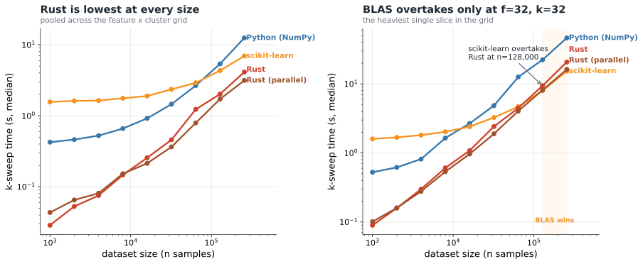
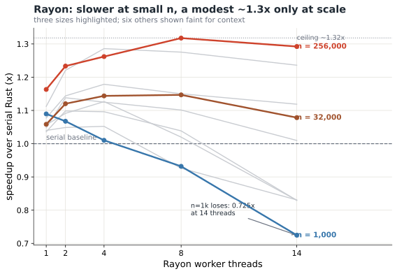
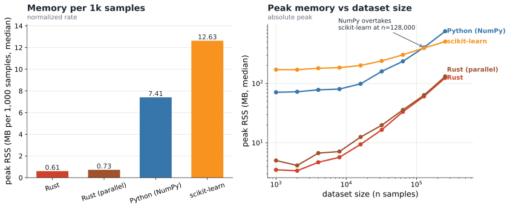

Open the [live demo](https://www.nilesh42.science/bench-kmeans-rust/demo/), pick a point distribution, and hit run. The first pass clusters your points with the hand-rolled Rust k-means from this post, compiled to WebAssembly. The second is a pure-JavaScript k-means on the *same* data and the *same* seed, timed beside it with `performance.now()` on your machine. I ran the native version of that race against NumPy and scikit-learn. At n=1,000, a full elbow sweep (load the CSV, fit every k from 1 to K, write results) takes my hand-rolled NumPy k-means 0.43 s and scikit-learn 1.57 s. The Rust binary does it in 0.029 s, roughly 15x over NumPy and 54x over BLAS-backed scikit-learn. Those are ratios of the median runtimes at n=1k; the median of paired per-dataset ratios there is 14.5x. All four implementations start from k-means++ initialization. By a quarter-million points the 14.5x has shrunk to 3.5x, and in one corner of the grid scikit-learn wins.

The four run one algorithm, Lloyd's assign-then-update loop:

1. **Hand-rolled NumPy** - Lloyd's loop written in Python, with the array arithmetic done by NumPy. The figures label it "Python (NumPy)" or "pure-Python" and the results CSV calls it Python; all of those mean this implementation.
2. **Serial Rust** - explicit loops, no interpreter, no per-operation allocations.
3. **Parallel Rust** - the *same* binary run with `--parallel --threads 0`, which turns on Rayon. It ran the whole grid like the other three.
4. **scikit-learn** at `n_init=1` - one start, like the rest.

**Four ways at a glance** (648 runs, Apple M4 Max, all implementations on k-means++ init):

| Implementation | Median wall time | Speedup vs NumPy | Median RSS / 1k rows | Median ARI |
|---|---|---|---|---|
| **Hand-rolled NumPy** | 0.806 s | 1.0x (baseline) | 7.41 MB | 1.00 |
| **Serial Rust** | 0.201 s | **4.5x** | **0.61 MB** | 1.00 |
| **Parallel Rust (Rayon)** | 0.197 s | **5.1x** | 0.73 MB | 1.00 |
| **scikit-learn** (`n_init=1`) | 1.843 s | 0.44x | 12.63 MB | 1.00 |

Serial Rust's lead shrinks with size, from 14.5x to 3.5x. Rayon adds at most 1.32x over serial in the thread sweep and more than 2x in two cells of the main grid (2 features, k_max=32). Rust uses the least memory at each size.

*How the speedup column is computed.* Each figure is a median of paired per-dataset ratios (NumPy time over the other implementation's time, one ratio per dataset), taken from [`specs/analysis_facts.md`](https://github.com/nilesh-patil/bench-kmeans-rust/blob/master/specs/analysis_facts.md) in the repo. scikit-learn's 0.44x also equals the ratio of the overall medians (0.806 / 1.843), but it averages over a reversal: 0.27x at n=1k, 1.80x at n=256k.

## The distance block

The cost per iteration is $O(nkd)$: each point against each centroid across each dimension. Almost all of it is the distance computation, and the distance computation contains a matrix multiply. Stack the data into $X$ (shape $n \times d$) and the $k$ centroids into a matrix $M$ (shape $k \times d$), one centroid per row. Expanding the square,

$$\lVert x_i - \mu_j \rVert^2 = \lVert x_i \rVert^2 - 2\, x_i \cdot \mu_j + \lVert \mu_j \rVert^2,$$

the cross term $x_i \cdot \mu_j$ over all pairs at once is the $n \times k$ matrix $X M^\top$, formed by contracting over the $d$ feature dimensions. The $O(nkd)$ work is in that contraction; the two norm terms are one cheap pass over the points and one over the centroids.

The implementations differ in how they produce those $n \times k$ distances. The NumPy version allocates the full matrix and fills it one centroid column at a time with `np.linalg.norm(X - centroids[k], axis=1)`. Serial Rust runs explicit loops and keeps only a running nearest index per point, so the matrix never exists. Its data is an array of structs (`Vec<DataPoint>`, each point owning a heap-allocated `Vec<f64>`). Parallel Rust is the same code with Rayon splitting the assign and update steps across worker threads. scikit-learn routes the cross term through a BLAS GEMM.

## The grid

One end-to-end CLI run per configuration: load CSV, fit k = 1..K, write CSV, exit. I time the whole subprocess, process launch included, because that is what a pipeline pays per call. The grid is 9 sizes (1k to 256k, doubling) × 3 feature counts (2/8/32) × 2 cluster budgets (k_max 8 or 32) × 3 repeats, on synthetic Gaussian blobs with k_max true clusters: 162 datasets × 4 implementations = 648 runs ([results CSV](https://github.com/nilesh-patil/bench-kmeans-rust/blob/master/results/benchmark_results_20260609_112255.csv)), on an Apple M4 Max. None of the 648 exited with an error and none is missing ARI or NMI.

The control I care most about is initialization. Every implementation seeds with k-means++, and scikit-learn runs at `n_init=1`. This is a rerun of an [earlier experiment](https://github.com/nilesh-patil/bench-kmeans-rust/blob/a2e82a5d37717b662a1b3b96e16435a85f436b1c/docs/index.md) that didn't control init.

Metrics are subprocess wall time, sampled peak RSS (polled every 10 ms, so it can miss brief spikes that a kernel max-RSS would catch), and ARI/NMI of the k = k_max fit against the ground-truth blob labels. For reference, the versions the repo pins in `pixi.lock` are rustc 1.87.0, NumPy 2.4.5, scikit-learn 1.8.0 and OpenBLAS 0.3.33; the results CSV does not record versions per run.

## Wall time against NumPy

Serial Rust is the NumPy version's arithmetic written as explicit loops. Across the full sweep that is worth a median 4.5x.

The 4.5x is a median of paired ratios, one NumPy-time-over-Rust-time ratio for each of the 162 datasets. The mean of the same ratios is about 6.6x, pulled up by the small-n cells where Rust does best, and the ratio of overall median runtimes is 4.02x.

<figure>
  
  <figcaption>Median end-to-end runtime vs dataset size, pooled over the whole grid (left) and for the heaviest slice alone, 32 features and k_max=32 (right).</figcaption>
</figure>

Pooled across the grid, Rust is the lowest line at each size and also the steepest: for 256x the rows its time grows about 144x (0.029 s to 4.13 s), where NumPy's grows 29x and scikit-learn's 4.4x. A log-log fit over the size-medians gives slopes of 0.902, 0.599 and 0.249, but NumPy and scikit-learn follow a power law only loosely (R² 0.911 and 0.831), so I don't read any of the three as an algorithmic exponent. What they do rank is fixed overhead: the flatter the slope, the larger the share of a run that is start-up and per-call cost.

<figure>
  
  <figcaption>Speedup over the hand-rolled NumPy (the axis label says pure-Python) against dataset size, as a median of paired ratios, with parity marked.</figcaption>
</figure>

Serial Rust goes from 14.5x at n=1k to about 3.5x at n=256k and stays above 3x throughout. scikit-learn comes from the other side. At n=1k it sits at 0.27x, nearly four times slower than the hand-rolled NumPy, because its fixed cost (library start-up, BLAS warm-up) dwarfs the fitting work. That cost amortizes as n grows, and scikit-learn reaches parity near n=128k and 1.80x at 256k. None of the small-n drag is restart cost, since it runs at `n_init=1`.

## Where scikit-learn wins: four cells of 54

scikit-learn has the flattest slope of the four because most of its cost is fixed and its per-row work is the cheapest, and at the top of the grid that catches my loops. Pooled over the grid, Rust still beats scikit-learn at the median at each size, 256k included. Cell by cell, scikit-learn is faster than serial Rust in 4 of the 54 (size, features, k_max) cells, and all four have k_max=32 and n ≥ 128k. Two of the four are at f=2, the narrowest data in the grid, and in those two the parallel build is ahead of scikit-learn. In the heaviest slice (f=32, k_max=32), scikit-learn finishes in 8.0 s against serial Rust's 9.4 s at 128k. At the light end Rust beats scikit-learn by 6x to 65x.

The single heaviest workload (256k rows, 32 features, k_max=32) puts the four in this order: scikit-learn 15.36 s, parallel Rust 16.23 s, serial Rust 20.76 s, hand-rolled NumPy 46.46 s. scikit-learn ran at 1.65 effective cores (CPU time over wall time, median of the three repeats; its median CPU time is 24.59 s) where serial Rust used 0.98. So part of its win there comes from using more than one core. The rest I put down to the GEMM keeping the distance block in cache and filling the vector units, which my scalar loops don't do. I haven't built the comparison that would test this, a Rust version with an `ndarray` GEMM for the cross term.

## Fourteen threads

Parallel Rust is one flag: `--parallel --threads 0` lets Rayon use all 14 cores. I swept thread counts (1, 2, 4, 8, 14) at each of the nine sizes, on separate 16-feature datasets at k_max=8.

<figure>
  
  <figcaption>Rayon speedup over serial Rust by thread count, one curve per dataset size (medians of 3).</figcaption>
</figure>

On 14 cores the loop runs barely faster than on one. The best speedup at any size in the sweep is 1.318x, at n=256k with 8 threads, and 14 threads there is slower than 8. At small n the threads cost time: n=1k falls to 0.725x at 14 threads. (The [benchmarks page](https://www.nilesh42.science/bench-kmeans-rust/benchmarks/) walks the thread-scaling curves in more depth.)

On the main grid the heaviest workload (256k/32/k_max=32) gets about 1.28x out of 1.31 effective cores. The grid's largest gains are in the 2-feature, k_max=32 cells: more than 2x at 128k and 256k rows, on about 3 effective cores. Across the grid the parallel build's median wall time is 0.197 s against 0.201 s serial, with a median of 1.87 effective cores (the hand-rolled NumPy baseline sits at a median 0.91). The parallel build's count is highest at n=1k, a median 2.92, where it is slower than serial. The 5.1x-over-NumPy paired figure is mostly the serial 4.5x plus the modest large-n thread gain.

Rayon covers only the assign and update steps. The CSV load, the k-means++ seeding and the CSV write run on one thread in both builds.

## Peak memory

Per 1,000 rows, the median sampled peak RSS is 0.61 MB for serial Rust against 7.41 MB for NumPy and 12.63 MB for scikit-learn, about 12x and 21x leaner, and the parallel build pays a small premium at 0.73 MB. Rust is lowest at each size in the grid. The gap narrows with size: by median peak RSS it is 20x and 49x at n=1k, and 6x and 4x at 256k.

<figure>
  
  <figcaption>Sampled peak RSS, normalized per 1,000 samples (left) and absolute by size (right).</figcaption>
</figure>

The other two do swap places. NumPy starts below scikit-learn and climbs past it at large n. In the heaviest workload (256k×32, k_max=32) scikit-learn peaks at 795 MB and NumPy at 924 MB, and both Rust builds sit near 190 MB (190 parallel, 194 serial).

The [earlier write-up](https://github.com/nilesh-patil/bench-kmeans-rust/blob/a2e82a5d37717b662a1b3b96e16435a85f436b1c/docs/index.md) credited this to a flat `Vec<f64>`, and I'd guessed wrong. The layout is an array of structs with a heap `Vec<f64>` and a string id per point, which is poor for cache locality. A flat contiguous `Vec<f64>` is an optimization I left undone, and I'd expect it to help the thread scaling and the large-n slope too.

## Clustering quality with matched init

In the earlier run the hand-rolled implementations used random init while scikit-learn used its default ten restarts, and Rust posted the worst clusterings of the four (ARI 0.66 against scikit-learn's 1.0).

With all four on k-means++ init, the median ARI is 1.00 for each, and serial and parallel Rust match in each quality column of the run summary. The means barely separate (scikit-learn 0.9988, NumPy 0.9802, Rust 0.9742). The count of runs that reach ARI ≥ 0.999 separates them more: 156 of 162 for scikit-learn, 113 for NumPy, 106 for Rust.

<figure>
  
  <figcaption>Clustering quality against runtime: mean ARI (left) and minimum ARI (right). The minimum is 0.958 for scikit-learn and 0.834 for Rust and NumPy.</figcaption>
</figure>

scikit-learn's remaining edge is that worst case, and at least part of it comes from its greedy k-means++ variant, which tries several candidate seeds at each step and keeps the best. Convergence tolerance and empty-cluster handling differ too, so the gap isn't all seeding.

k-means++ itself, due to Arthur and Vassilvitskii in 2007, changes the seeding and leaves the loop alone. In a standalone ablation on the Python implementation with 10 seeds per config, switching random init to k-means++ cut final inertia by 37% to 54%, and the cut grows with k and dimension.

<figure>
  
  <figcaption>Reduction in final inertia from switching random init to k-means++, for three configurations of growing size, dimension, and cluster count: 37.2%, 53.1%, 54.4% (10 seeds each).</figcaption>
</figure>

## Choosing between the four

If the bottleneck is a NumPy k-means, hand-rolled serial Rust runs about 4.5x faster at the median on roughly a twelfth of the memory. At large n *and* large k, tuned linear algebra wins; if I needed that corner I would try a flat-matrix, GEMM-backed Rust before adding threads.

The slopes above reflect my M4 Max's cache hierarchy and BLAS build as much as the algorithm, so the n where scikit-learn overtakes naive Rust will land somewhere else on your machine. The four implementations, the sweep harness, and the full Plotly dashboards are in the repo.

[Race WASM vs JS in the live demo](https://www.nilesh42.science/bench-kmeans-rust/demo/){: .btn-soft .btn-soft--primary} [Read the project write-up](https://www.nilesh42.science/bench-kmeans-rust/){: .btn-soft} [Browse the code](https://github.com/nilesh-patil/bench-kmeans-rust){: .btn-soft}
